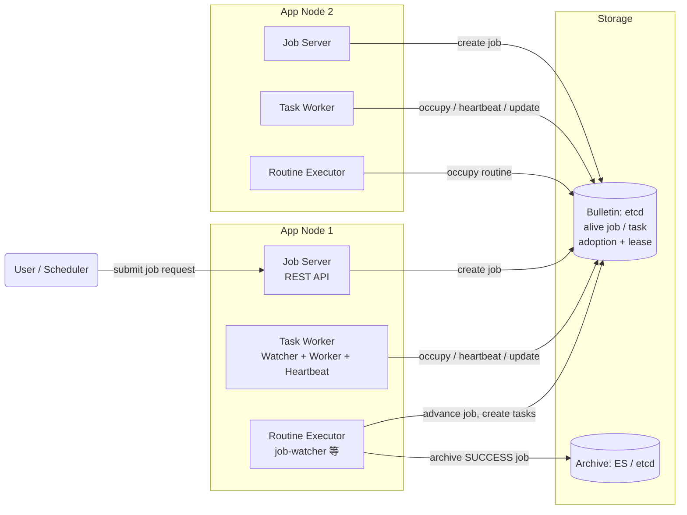
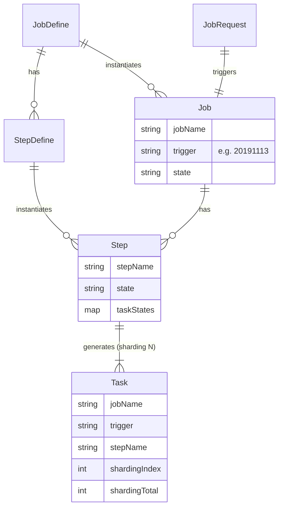
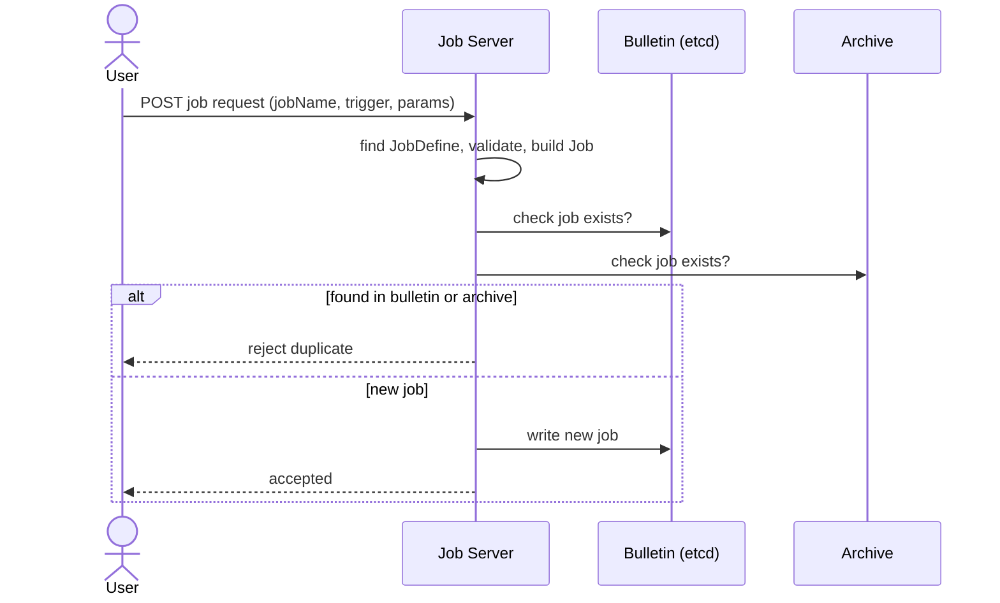
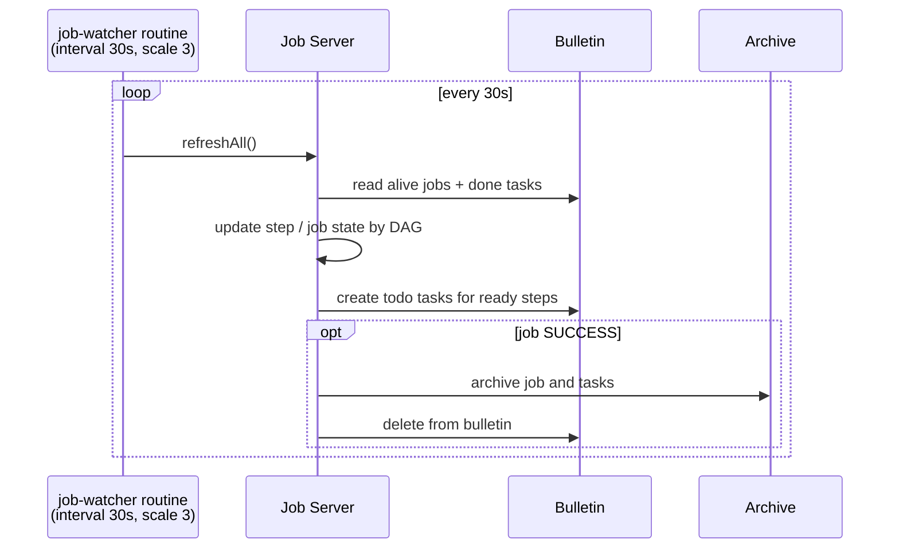
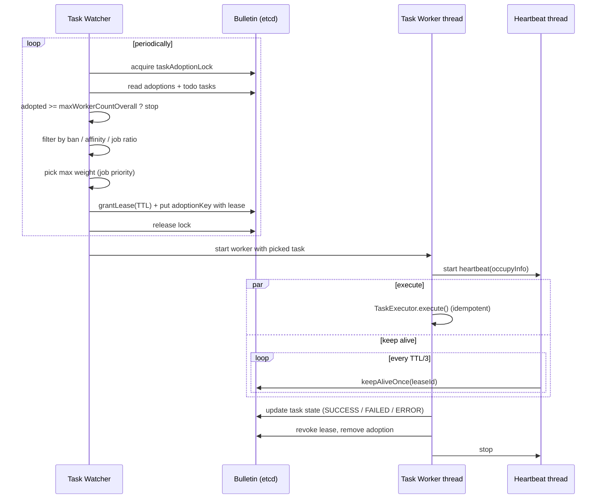
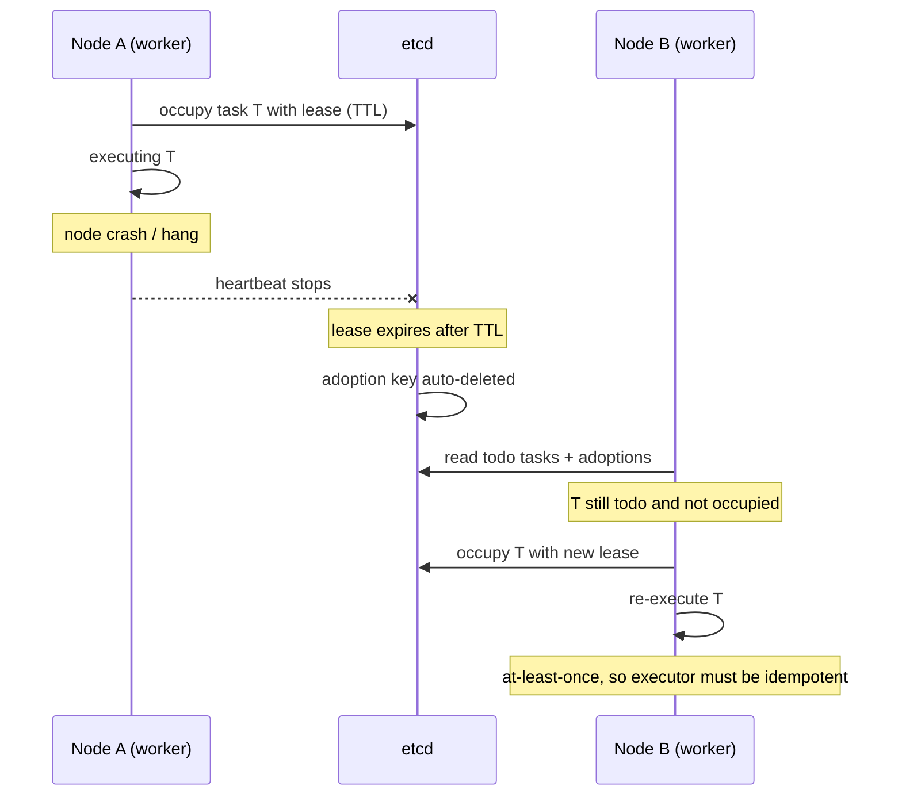
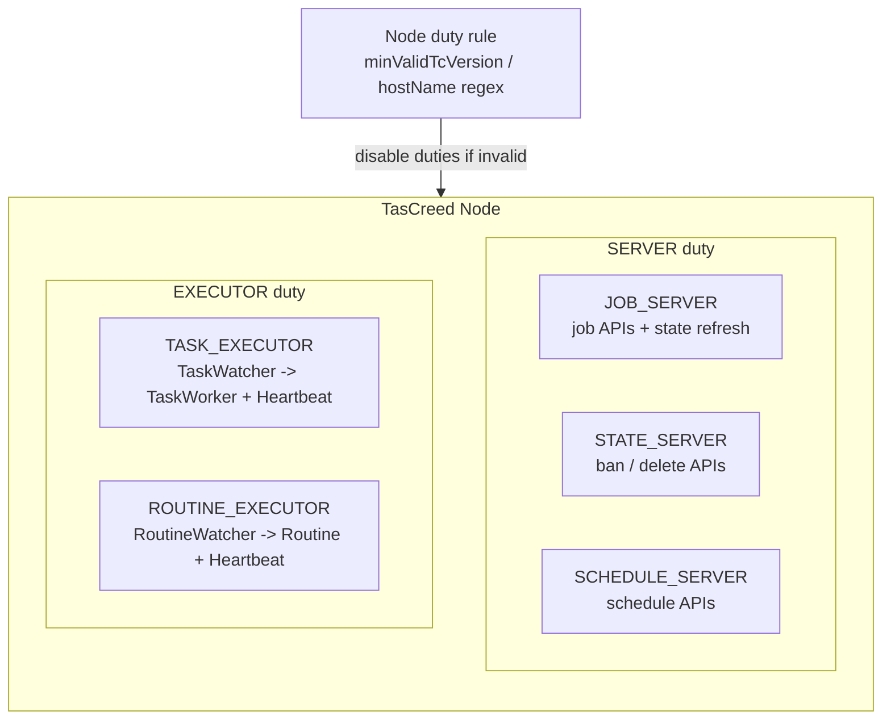
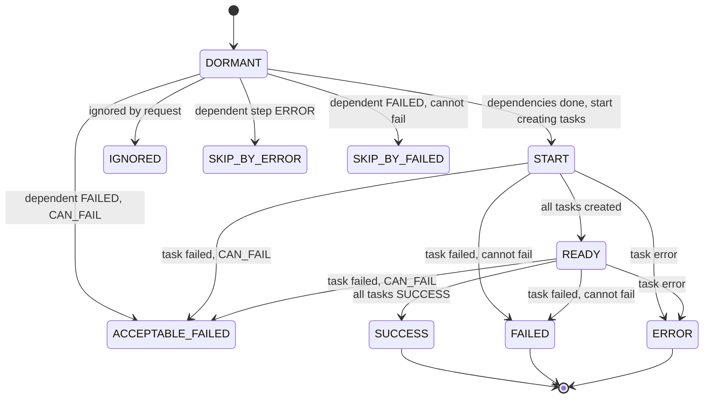
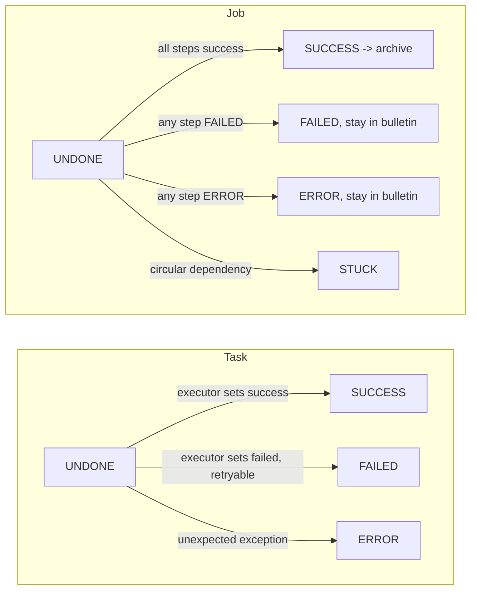
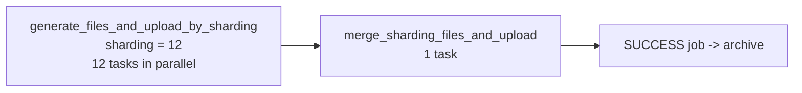

# TasCreed 架构与流程图

基于开源仓库 `TasCreed` 的文档和代码整理（`TaskOccupyHelper`、`TaskHeartBeatThread`、`BaseOccupyEtcdBulletin`、`JobWatcherRoutineExecutor`、`States.md`）。
图使用 mermaid 编写，GitHub / VS Code（Markdown Preview Mermaid 插件）可直接渲染。

> 内部线上版本与开源版本的差异待补，下面的图只代表开源版本。

---

## 1. 整体架构

每个 App 节点功能对等（无 leader），TasCreed 以 library 形式嵌入业务应用。

## 2. 核心概念模型

## 3. Job 提交流程

## 4. Job 推进（job-watcher routine）

## 5. Task 抢占与执行（核心）

## 6. 节点宕机后的故障恢复

## 7. 线程与职责模型

## 8. Step 状态机

## 9. Task / Job 状态

## 10. 示例：报表 Job 的 Step DAG（示意）

示例结构来自 `docs/design/Concept.md` 的 `balance-report`，真实报表 Job 的 Step 与分片数待补。

---

## 11. 适用场景（应用角度）

以下根据框架设计推导：至少一次执行、Task 为分钟级粒度、Job Watcher 30 秒轮询、抢 Task 有全局锁。

### 适合

| 场景 | 为什么适合 | 用到的能力 |
| --- | --- | --- |
| 日终 / 定时批处理（报表、对账、结算） | 节点挂了无需人工介入，Job 最终会跑完；`jobName + trigger`（如日期）天然防重复提交 | Job 去重、故障自动恢复、Schedule 定时触发 |
| 大批量数据分片并行处理 | 一个 Step 拆成 N 个 Task，分散到多节点并行 | `sharding`、Step DAG（分片生成 → 合并上传） |
| 多阶段流水线（ETL、生成文件 → 校验 → 上传 → 通知） | Step 依赖构成 DAG，上游成功才会触发下游 | Step 依赖、`CAN_FAIL`、Phase |
| 长驻的小批量消费任务 | 需要集群内保证只有指定数量的实例在跑，挂了自动接管 | Routine（`scale`、`interval`） |
| 需要灰度或多机房的任务集群 | 按版本、主机名控制哪些节点可以执行 | Node Duty、Ban |
| 失败后需要人工重试的批任务 | 非 SUCCESS 的 Job 留在 bulletin，可以手动重试 | FAILED / ERROR 状态、Ban 和删除 API |

### 不适合

| 场景 | 原因 |
| --- | --- |
| 低延迟、实时请求处理 | Job Watcher 30 秒一轮，Task 抢占还要拿全局锁，端到端延迟是秒到分钟级 |
| 海量极小任务（每秒成千上万） | 全局 `taskAdoptionLock` 串行化抢占，且有 `maxWorkerCountOverall` 上限 |
| 要求 exactly-once 且任务无法做幂等 | 框架只保证至少一次，节点宕机后会重跑 |
| 需要严格顺序或强一致的分布式事务 | 框架不提供，Task 之间只有 Step 级别的依赖 |
| 带人工审批、复杂分支的业务工作流 | 这是 DAG 批执行框架，不是 BPM 引擎 |

### 我们的使用（待补）

- 财务报表 Job 的 Step 划分、分片数、触发方式（定时或手动）：待补。
- 幂等的具体做法（覆盖写、upsert、文件名带 trigger）：待补。
- 使用 `CAN_FAIL`、Routine、Node Duty、Ban 的实际情况：待补。
- 线上遇到的故障或重复执行事件：待补。

### 面试中被问到"为什么不用 X"

| 对比对象 | 可以这样答（先确认符合你们当时的实际情况） |
| --- | --- |
| Quartz / 单机定时任务 | 单机没有故障转移，也不能把一个任务拆成分片并行 |
| 带 leader 的调度框架（XXL-Job、Elastic-Job 等） | leader 要管理所有 Worker 的存活，设计更复杂；这里无 leader，Worker 自己抢，部署和扩容更简单 |
| Airflow / 工作流引擎 | 我们的任务嵌在业务应用里，以 library 形式使用，不想额外部署一套调度平台 |
| 消息队列消费 | 队列没有 Step 依赖、Job 状态、归档和重试管理，这些得自己实现 |

> 上表是通用对比，不是我们当时的决策记录，面试前需要你确认真实原因。
