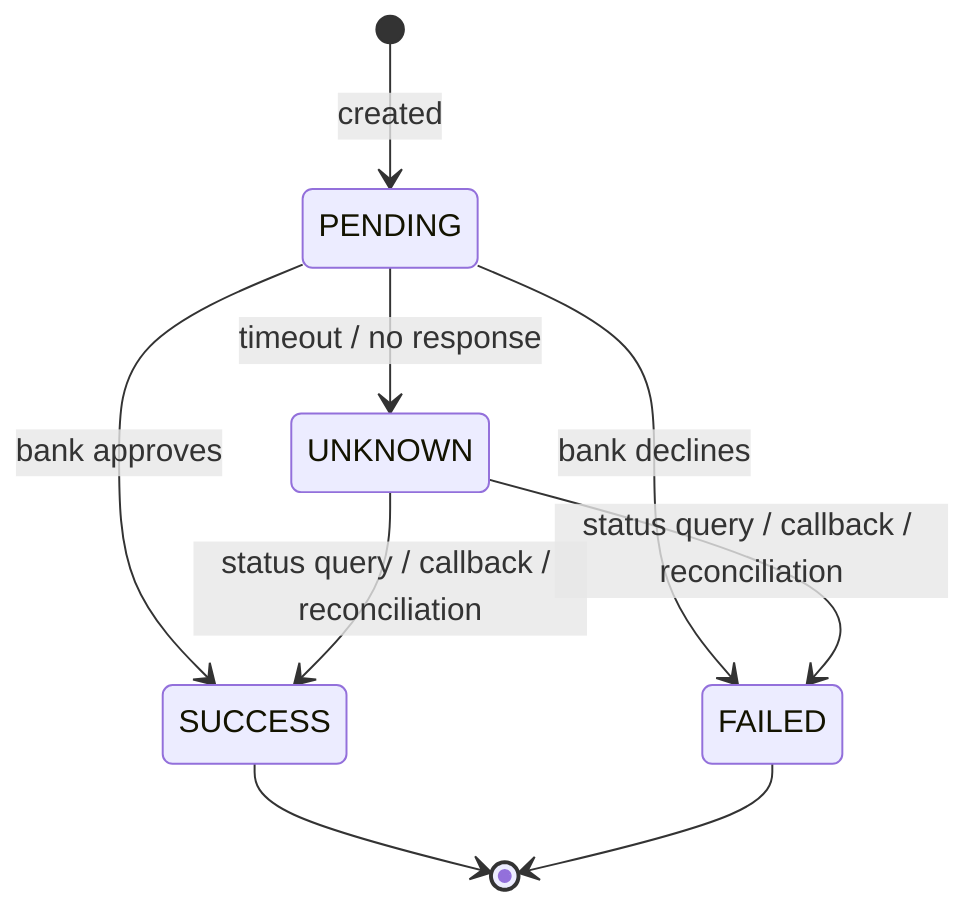
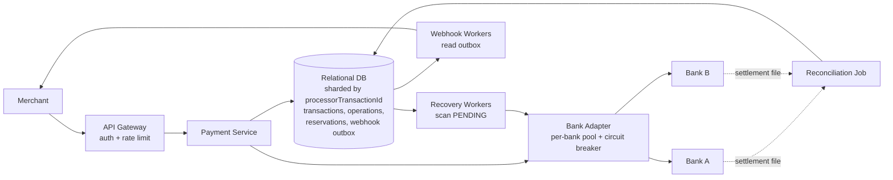
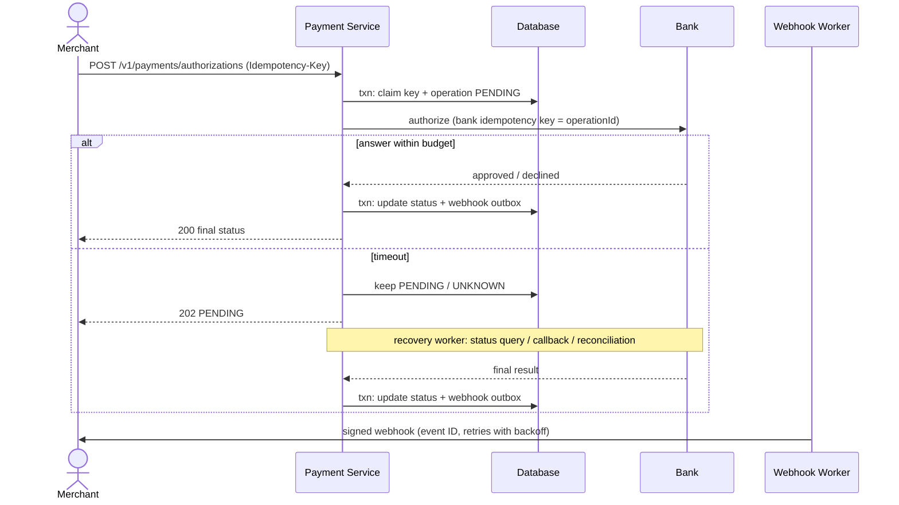
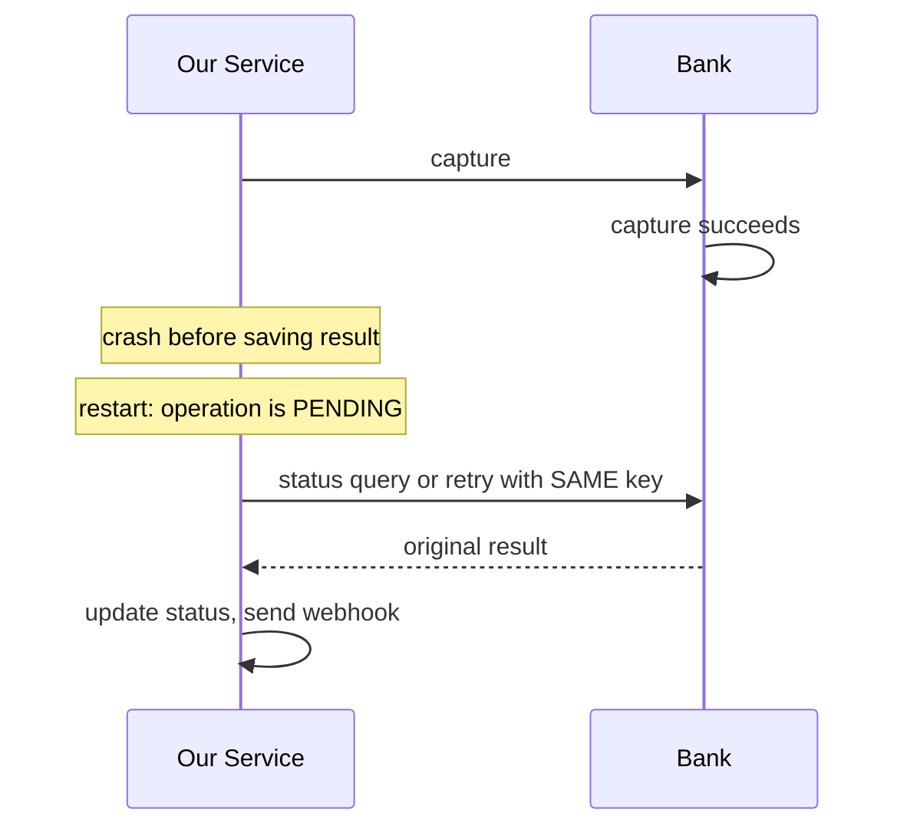

# System Design 面试准备：支付系统（Checkout.com）

基于一次 mock interview 整理。题目：**Design a payment processing system for merchants.**
全英文面试，所以口述稿用英文，解释用中文。

目录

1. 开场框架
2. Clarify 问题清单
3. 估算
4. API 与数据模型
5. 核心流程（6 步）
6. Deep dive 主题
7. 架构图
8. 一分钟总结稿
9. 追问与答案
10. 你的经验怎么接
11. 常用英文表达
12. 易错点与待补

---

## 1. 开场框架

每道题都按这 6 步走，约 45 分钟：

| 步骤 | 时间 | 做什么 |
| --- | --- | --- |
| 1. Clarify | 3–5 分钟 | 功能、规模、一致性、可用性 |
| 2. 估算 | 3 分钟 | QPS、存储 |
| 3. API 与数据模型 | 5–8 分钟 | 接口、表、状态机 |
| 4. High-level 架构 | 5 分钟 | 画图，讲主流程 |
| 5. Deep dive | 15–20 分钟 | 幂等、超时、一致性、故障 |
| 6. 监控与扩展 | 5 分钟 | 指标、告警、分库、容灾 |

开场第一句：

> "Let me start by clarifying the requirements, then I'll estimate the scale, design the API and data model, draw the high-level architecture, and then go deep on the hard parts."

**支付系统开场就要说明优先级：**

> "For a payment system, **correctness comes first**. We must never charge a customer twice or lose track of a payment. I'd rather reject some requests during a failure than risk a wrong charge. Availability and latency are important, but they come second."

---

## 2. Clarify 问题清单

### 要问的问题

| 类别 | 问题 |
| --- | --- |
| 范围 | 有哪些操作？authorization、capture、refund？哪些不在范围内（风控、结算、卡数据存储）？ |
| 外部依赖 | 对接多少个银行或卡组织？各自的 API 有什么能力（有没有幂等键、状态查询）？ |
| 规模 | 平均 QPS 和峰值 QPS？是所有商户的总量吗？商户分布是否不均？ |
| 延迟 | 商户期望的响应时间？ |
| 币种 | 单币种还是多币种？ |
| 租户 | 多租户吗？ |

### 这次 mock 得到的答案

- 银行：约 10 个，未来 30–50 个；各自 API、延迟、故障行为不同。
- 范围内：authorization、capture、refund；对商户的 API；内部支付状态；银行集成。
- 范围外：风控、商户接入、UI、结算与打款、卡数据存储和 PCI（假设有 vault 服务提供 token）。
- 规模：平均 1,000 笔/秒，峰值 5,000 笔/秒，是所有商户的总量。
- 流量不均：少数大商户占大部分，大商户做促销时会突发。
- 延迟：大多数请求 2–3 秒内返回。
- 币种：单币种，多币种暂不考虑。
- 多租户：是。

### 功能需求（白板上这样写）

1. 商户 API：三个操作，**authorization**（验卡并预留额度）、**capture**（真正扣款）、**refund**（退款）。capture 和 refund 都引用 authorization 时生成的 `processorTransactionId`。
2. 跟踪每笔支付和每个操作的状态。
3. 与银行交互，处理失败和超时。
4. 状态变化时通知商户（webhook），也支持查询。

### 非功能需求

1. **Correctness**：不重复扣款，不丢失支付，账务可审计。
2. **Reliability / Availability**：银行故障不拖垮整个系统。
3. **Latency**：多数请求 2–3 秒内返回。
4. **Throughput**：平均 1,000，峰值 5,000 笔/秒。
5. **Observability**：指标、监控、告警、可追踪。
6. **Security**：认证、签名、不记录卡数据。

---

## 3. 估算

| 项目 | 计算 | 结果 |
| --- | --- | --- |
| 每天笔数 | 1,000 × 60 × 60 × 24 | 约 86.4 million |
| 每条记录大小 | 假设 1 KB（请求体、状态、引用） | 1 KB |
| 每天存储 | 86.4M × 1 KB | 约 86 GB |
| 每年存储 | 86 GB × 365 | 约 30 TB |
| 峰值写入 | 5,000 笔/秒，每笔含 operation、状态更新、webhook 事件，约 3–5 次写 | 约 15,000–25,000 次写/秒 |

**易错点：** 86.4M × 10 KB × 365 约等于 300 TB，不是 300 GB。先用 1 KB，说出假设再讲。

**数据保留：** 不能随便删。要考虑监管、争议和 chargeback，保留到 chargeback 期限之后。热数据放关系型数据库，旧数据归档到更便宜的存储，但仍然可查。

---

## 4. API 与数据模型

### 4.1 生命周期与 ID

一笔付款分三个操作，**用同一个 `processorTransactionId` 串起来**：

```text
Authorization ──▶ Capture ──▶ Refund
创建这个 ID        引用它       引用它
```

| | Authorization | Capture | Refund |
| --- | --- | --- | --- |
| 作用 | 验卡，向发卡行预留额度，**不扣款** | 真正扣款 | 退款 |
| 和 ID 的关系 | **创建** `processorTransactionId` | 引用它 | 引用它 |
| 参数 | 卡信息、金额、币种（最多，因为要让发卡行判断） | 金额、币种（必须等于授权额），其余都在 auth 里 | 金额、币种，可部分、可多次 |

| ID | 谁生成 | 用途 |
| --- | --- | --- |
| `processorTransactionId` | 我们，在 auth 时生成，只出现在响应里 | 商户用它引用这笔交易（capture、refund、查询） |
| `operationId` | 我们，每次 API 调用生成 | 标识一次操作；同时作为银行幂等键 |
| `merchantReference` | 商户（可选） | 商户自己的订单号，方便对账，不能代替 ID |
| `Idempotency-Key`（请求头） | 商户 | 防重复提交，每个请求一个 |
| 银行引用 | 银行 | 只保存在内部，auth 的引用供 capture 使用 |

**范围：** auth → capture → refund，不含 void，不含“auth + capture 一步完成”。

### 4.2 Authorization

验卡并预留额度，不扣款。

**Request**

```http
POST /v1/payments/authorizations
Idempotency-Key: auth-order-100-1
```

```json
{
  "card": { "token": "tok_abc123" },
  "amount": 1000,
  "currency": "GBP",
  "merchantReference": "order_100"
}
```

| 字段 | 必填 | 说明 |
| --- | --- | --- |
| `Idempotency-Key`（请求头） | 是 | 防重复提交 |
| `card.token` | 是 | 卡信息。vault 服务生成 token，不传完整卡号（PCI 不在范围内） |
| `amount` | 是 | 最小货币单位（pence），避免浮点 |
| `currency` | 是 | 币种 |
| `merchantReference` | 否 | 商户订单号，方便对账 |

最小版本，生产环境还会有 customer、billingAddress、3DS、descriptor、metadata 等，这里为聚焦核心流程省略。`processorTransactionId` 不在请求里，由我们生成。

**Response**

```json
{
  "processorTransactionId": "ptx_789",
  "operationId": "op_001",
  "status": "AUTHORIZED",
  "amount": 1000,
  "currency": "GBP"
}
```

| status | HTTP | 说明 |
| --- | --- | --- |
| `AUTHORIZED` | 200 | 批准，可以 capture |
| `DECLINED` | 402 | 发卡行拒绝；响应体仍有 `processorTransactionId`、`errorCode`、`retryable` |
| `PENDING` | 202 | 超时或未知；**仍然返回 `processorTransactionId`**，商户用 GET 查询并等 webhook |
| 请求不合法 | 400 / 422 | 缺字段、金额非法、同一个 key 带了不同内容 |

DECLINED 示例：

```json
{
  "processorTransactionId": "ptx_790",
  "operationId": "op_010",
  "status": "DECLINED",
  "errorCode": "INSUFFICIENT_FUNDS",
  "retryable": false
}
```

**设计说明：**

- 被拒的 auth 也生成 `processorTransactionId`，因为它是要审计和对账的记录，但不能被 capture。
- 402 和 400/422 要区分：402 是“请求合法，但发卡行不同意”；400/422 是请求本身有问题。
- 商户不能对 402 自动重试。`retryable` 区分软拒绝（可换卡再试）和硬拒绝（如被盗卡，不应再试）。
- 同一个幂等键重放，返回同一个 402 结果，不会再次调用银行。
- 状态码可能被客户端或代理区别对待，所以靠 `errorCode` 和 `retryable` 说明，不要只看状态码。

> "I return 402 when the issuer declines, with the transaction ID and a clear error code, so the merchant can tell a declined card from an invalid request. A declined authorization still gets an ID, because we keep it for audit and reconciliation."

若面试官问“为什么不用 200”：

> "Both work. Some payment APIs return 200 with a declined status, because a decline is a normal business outcome. I chose 4xx so that clients can't treat a decline as a success by mistake. Either way, the response body has the same details."

**内部流程：** 走核心流程 6 步：生成 `processorTransactionId` 和 `operationId` → 写 operation 记录 → 用 `operationId` 作为银行幂等键调用银行授权 → 保存银行返回的授权引用（供 capture 使用）。

### 4.3 Capture

从已预留的额度里真正扣款。**只支持对一个 auth 做一次全额 capture。**

卡和金额币种已在 auth 里，capture 只需要说“扣多少”，并用 `processorTransactionId` 找到对应的 auth。

**Request**

```http
POST /v1/payments/ptx_789/captures
Idempotency-Key: capture-order-100-1
```

```json
{
  "amount": 1000,
  "currency": "GBP",
  "merchantReference": "order_100"
}
```

| 字段 | 必填 | 说明 |
| --- | --- | --- |
| `processorTransactionId`（路径） | 是 | auth 响应里拿到的 ID |
| `Idempotency-Key`（请求头） | 是 | 防重复 capture |
| `amount` | 是 | **必须等于授权额**；必填是为了让商户明确确认金额，防止传错 |
| `currency` | 是 | 必须和 auth 一致 |
| `merchantReference` | 否 | 商户订单号，方便对账 |

**Response**

```json
{
  "processorTransactionId": "ptx_789",
  "operationId": "op_002",
  "status": "CAPTURED",
  "amount": 1000,
  "currency": "GBP"
}
```

| status | HTTP | 说明 |
| --- | --- | --- |
| `CAPTURED` | 200 | 已确认扣款 |
| `PENDING` | 202 | 未知，等恢复或 webhook；保持 CAPTURING，不能被再次 capture |
| `FAILED` | 402 | 银行明确拒绝（沿用 auth 的做法） |

**本地校验（先于银行调用）：**

| 情况 | HTTP | errorCode |
| --- | --- | --- |
| `processorTransactionId` 不存在或不属于该商户 | 404 | `TRANSACTION_NOT_FOUND` |
| auth 不是 AUTHORIZED（被拒、已过期） | 409 | `AUTHORIZATION_NOT_CAPTURABLE` |
| 已经 capture 过（用了不同的 key） | 409 | `ALREADY_CAPTURED` |
| 金额不等于授权额，或币种不一致 | 422 | `AMOUNT_MISMATCH` / `CURRENCY_MISMATCH` |
| 同一个 key 带了不同内容 | 422 | `IDEMPOTENCY_KEY_REUSED` |

**并发控制：** 条件更新 `UPDATE ... SET status='CAPTURING' WHERE status='AUTHORIZED'`。两个并发的 capture（不同 key）只有一个能更新成功，所以不需要金额预留表；另一个得到 409。同一个 key 的重复请求由幂等记录处理，返回已有结果。

**内部流程：** 走核心流程 6 步。调用银行时带上 auth 时保存的**银行授权引用**，用 capture 自己的 `operationId` 作为银行幂等键，保存银行返回的 capture 引用（供 refund 使用）。

> "Capture only needs the transaction ID, the amount, and the currency, because the card and customer data are already on the authorization. We allow one full capture per authorization, so the amount must match. Two concurrent captures can't both succeed: we move the authorization from AUTHORIZED to CAPTURING with a conditional update, and only one wins."

### 4.4 Refund

把已扣的钱退回给持卡人。引用 `processorTransactionId`。因为 capture 只能一次全额，所以**可退总额 = 授权额（已 capture 金额）**。支持**部分退款，可多次**，累计不超过已 capture 金额。

**Request**

```http
POST /v1/payments/ptx_789/refunds
Idempotency-Key: refund-order-100-1
```

```json
{
  "amount": 700,
  "currency": "GBP",
  "merchantReference": "order_100"
}
```

| 字段 | 必填 | 说明 |
| --- | --- | --- |
| `processorTransactionId`（路径） | 是 | auth 响应里的 ID |
| `Idempotency-Key`（请求头） | 是 | 防重复退款 |
| `amount` | 是 | 要退多少；不能超过剩余可退金额 |
| `currency` | 是 | 必须和原交易一致 |
| `merchantReference` | 否 | 商户订单号，方便对账 |

**Response**

```json
{
  "processorTransactionId": "ptx_789",
  "operationId": "op_003",
  "status": "REFUNDED",
  "amount": 700,
  "currency": "GBP",
  "refundableAmount": 300
}
```

`refundableAmount` 是这次退款之后还剩多少可退。

| status | HTTP | 说明 |
| --- | --- | --- |
| `REFUNDED` | 200 | 银行确认退款 |
| `PENDING` | 202 | 未知，保持预留，等恢复或 webhook |
| `FAILED` | 402 | 银行明确拒绝，预留释放 |

**本地校验：**

| 情况 | HTTP | errorCode |
| --- | --- | --- |
| 交易不存在 | 404 | `TRANSACTION_NOT_FOUND` |
| 还没有成功的 capture | 409 | `NOTHING_TO_REFUND` |
| 超过剩余可退金额 | 422 | `AMOUNT_EXCEEDS_REFUNDABLE` |
| 币种不一致 | 422 | `CURRENCY_MISMATCH` |
| 同一个 key 带了不同内容 | 422 | `IDEMPOTENCY_KEY_REUSED` |

**并发控制（和 capture 不同）：** 退款可以多次、部分，所以不能只靠状态条件更新，要用**金额预留**：在短事务里锁住该交易的余额行，检查 `captured − 已退款 − 已预留`，预留金额，写入 operation（PENDING），提交后再调银行。银行结果未知时不能释放预留。详见第 5 节“退款：并发时防止多退”。

**内部流程：** 走核心流程 6 步。调用银行时带上 capture 保存的**银行 capture 引用**，用 refund 自己的 `operationId` 作为银行幂等键。

> "Refund needs the transaction ID, an amount, and a currency. Partial refunds are allowed, many times, up to the captured amount. Since two refunds can arrive at the same time, we reserve the amount in a short database transaction before calling the bank."

### 4.5 查询与通用

```http
GET /v1/payments/{processorTransactionId}
```

返回交易当前状态和它所有的操作（auth、capture、refund 及各自的状态和金额）。商户收到 202 PENDING，或 webhook 丢了，靠它拿最新状态。

商户身份来自 API key 或 OAuth token，在 API gateway 认证，不从请求体里取。

### 4.6 完整例子：£10.00 的订单

```text
1. POST /v1/payments/authorizations   amount=1000
   → 200 AUTHORIZED, processorTransactionId = ptx_789

2. POST /v1/payments/ptx_789/captures amount=1000
   → 200 CAPTURED

3. POST /v1/payments/ptx_789/refunds  amount=700
   → 200 REFUNDED, refundableAmount = 300

4. POST /v1/payments/ptx_789/refunds  amount=700 （新 key）
   → 422 AMOUNT_EXCEEDS_REFUNDABLE（只剩 300）
```

每一步在我们内部：写一条 operation 记录 → 用 `operationId` 作为银行幂等键调用银行 → 保存银行引用。**capture 用 auth 的银行授权引用，refund 用 capture 的银行引用。**

### 4.7 面试时怎么讲 API

> "There are three operations. Authorization checks the card and reserves funds, but doesn't take money. It creates a processor transaction ID and returns it. Capture and refund reference that ID in the path, because the card data is already on the authorization.
>
> Capture is one full capture per authorization, so the amount must match. Refund can be partial and repeated, up to the captured amount, so we reserve the amount before calling the bank.
>
> Each call is its own operation with its own idempotency key, and an operation ID that we use as the bank's idempotency key. For capture and refund, we send the bank the reference it gave us earlier."

**通用 HTTP 状态：**

| HTTP 状态 | 含义 |
| --- | --- |
| 200 | 已有最终结果 |
| 202 | 已接受，处理中（PENDING） |
| 400 / 422 | 请求内容错误；同一个 key 带了不同内容 |
| 401 / 403 | 认证或权限 |
| 402 | 发卡行或银行拒绝 |
| 429 | 超过限流，带 Retry-After |

### 数据模型

```text
transaction                     （一个 processorTransactionId 一条，从 auth 开始）
  processor_transaction_id, merchant_id, currency, authorized_amount,
  captured_amount, refunded_amount, status, auth_expires_at,
  bank_auth_reference, bank_capture_reference, created_at

operation                       （每次 authorize / capture / refund 一条）
  operation_id, processor_transaction_id, type, amount, currency,
  status, bank_id, bank_reference, bank_idempotency_key,
  created_at, updated_at

idempotency_key
  merchant_id, operation_type, idempotency_key   （联合唯一）
  request_hash, operation_id, response

balance_reservation             （仅退款预留金额；capture 用条件更新）
  reservation_id, processor_transaction_id, operation_id, amount, status

webhook_outbox                  （仅 webhook 事件）
  event_id, type, payload, status, created_at, sent_at

state_transition_history        （审计：每次状态变化只追加）
  operation_id, from_status, to_status, reason, at
```

要点：

- **transaction 和 operation 分开**：支持多次部分退款，不覆盖历史。
- **追加式历史**：状态变化只追加，不修改旧记录。
- **同一 processorTransactionId 的数据在同一个分片**：余额检查在一个本地事务里完成。

### 状态机



规则：只有明确结果才能进入终态；SUCCESS 和 FAILED 不能再改变；更新用条件 UPDATE（`WHERE status = 'PENDING'`）或乐观锁。

---

## 5. 核心流程（6 步）

```text
1. 接收请求   认证商户，限流
2. 幂等检查   数据库唯一键占位，校验请求指纹
3. 先落库     一个事务写 key 和 operation（PENDING）
4. 调用银行   同一个银行幂等键，短超时
5. 处理结果   成功 / 失败 / 未知
6. 通知商户   同步返回结果，或 pending + webhook
```

每一步回答三件事：做什么、为什么、出故障怎么办。

| 步骤 | 一句话 | 口诀 |
| --- | --- | --- |
| 1 | 认证、限流 | Authenticate, limit |
| 2 | 占位、比对 | Claim → Compare |
| 3 | 先存后调 | Save first, call later |
| 4 | 同 key，短超时 | Same key, short timeout |
| 5 | 超时 = 未知 | Timeout = unknown |
| 6 | 一起存，退避重试 | Save together, retry with backoff |

### 第 1 步：接收请求

- API gateway 认证商户，按商户限流（token bucket）。
- 超限返回 429 和 Retry-After。
- 大商户可按协议提高限额；队列或配额按商户隔离，防止一个商户占满资源。

### 第 2 步：幂等检查

**为什么：** 商户会重试（网络超时、用户连点）。没有幂等，同一笔付款可能被扣两次。

> "Every request carries an idempotency key. We claim the key in our database first. Only one request gets to process it."

唯一键：`(merchant_id, operation_type, idempotency_key)`，并保存 `request_hash`。

| 情况 | 处理 |
| --- | --- |
| 新 key | 插入成功，继续处理 |
| 同 key、同内容、已完成 | 返回保存的结果 |
| 同 key、同内容、处理中 | 返回已有 operation ID 和当前状态，不再调用银行 |
| 同 key、不同内容 | 拒绝，返回 422 |

**并发重复：** 两个请求同时 insert，唯一约束保证只有一个成功，另一个读取已有记录。不要“先查再插”，会有竞态。

**最关键的一点：数据库唯一键只保护我们自己的系统，保护不了银行那一侧。**

```text
我们 ── 调用银行扣款 ──▶ 银行（已扣款成功）
我们 ✗ 崩溃，没保存结果
重启后：数据库里是 PENDING，我们不知道银行有没有扣
```

所以还需要：银行幂等键、PENDING 状态、恢复机制（查询、回调、对账）。

记忆口诀：Claim → Compare → Call → Confirm（占位、比对、调用、确认）。

> "For idempotency, each request carries a key from the merchant. We store it with the merchant ID, the operation type, and a hash of the request. There is a unique constraint on the first three, so if two identical requests arrive together, only one inserts the key. The other one reads the existing record and returns its status. If the same key comes with a different amount, we reject it, because that is a client error.
>
> But the database constraint only protects us. If the bank captures the payment and we crash before saving the result, we need more. So we send a stable idempotency key to the bank, we keep the operation as pending, and we recover it by status query or reconciliation."

### 第 3 步：先落库（key + PENDING）

**为什么：** 调用银行是外部操作，不能回滚。必须先把“要做什么”持久化。

```text
BEGIN TRANSACTION
  1. 插入 idempotency key
  2. 插入 operation 记录，status = PENDING
COMMIT
```

这个事务里只有两件事，各自解决一个问题：

| 写什么 | 防什么 |
| --- | --- |
| 商户的 idempotency key（唯一键） | 商户重复提交同一个请求 |
| operation，状态 PENDING（“我要调银行”的意图） | 我们崩溃后，忘了要调银行 |

**PENDING 记录本身就是任务。** 崩溃重启后，恢复 worker 扫描超过一定时间的 PENDING 记录（`status, updated_at` 建索引），用 `SELECT ... FOR UPDATE SKIP LOCKED` 或租约认领，先向银行查询真实状态，再决定重试还是更新结果。不需要额外的 outbox 来调度“调银行”。

> outbox 只用在第 6 步的 webhook：最终结果和 webhook 事件要同事务保存，而且投递有自己的重试状态。

**同步优先：** API 提交后直接调银行，2–3 秒内拿到结果就返回；超时转 PENDING，后台继续。同步路径和后台 worker 用同一条 operation 和同一个银行幂等键，绝不各自创建扣款。

**崩溃的 3 个时间点：**

| 崩溃位置 | 数据库里有什么 | 恢复 |
| --- | --- | --- |
| 事务提交前 | 什么都没有 | 商户用同一个 key 重试，按新请求处理 |
| 提交后，调银行前 | PENDING | 恢复 worker 扫到，先查银行状态，再用同一个银行幂等键调用 |
| 调银行后，保存结果前 | PENDING | 恢复 worker 先查银行状态，或用银行幂等键重试，最后对账 |

> "Before calling the bank, we save two things in one transaction: the merchant's idempotency key, and the operation with status pending. The key stops the merchant from submitting the same request twice. The pending row records our intention to call the bank, so if we crash, we don't forget. A recovery worker scans old pending operations, asks the bank for the real status first, and then continues. The bank call uses a stable idempotency key, so a retry can't charge twice."

口诀：Save first, call later. Key + pending. Recover by status.

### 第 4–5 步：调用银行和处理结果

**4 个规则：**

| 规则 | 做法 |
| --- | --- |
| 稳定幂等键 | 用 operation ID 作为银行请求 key，重试时不变 |
| 短超时 | 每个银行单独设置，比整体响应预算短 |
| 隔离 | 每个银行独立连接池和熔断器 |
| 只重试安全的情况 | 见下表 |

**3 种结果：**

| 结果 | 判断 | 状态 | 处理 |
| --- | --- | --- | --- |
| 明确成功 | 银行批准 | SUCCESS | 保存银行引用号，通知商户 |
| 明确失败 | 银行拒绝（余额不足、卡无效） | FAILED | 通知商户，释放预留 |
| 未知 | 超时、断连、5xx、崩溃 | PENDING / UNKNOWN | 保持预留，不盲目重试，走恢复 |

> **超时 = 未知，不是失败。**

| 情况 | 能确定银行没处理吗 | 处理 |
| --- | --- | --- |
| 连接建立前失败（DNS、连接被拒） | 能 | 可安全重试或换银行 |
| 银行明确返回拒绝码 | 能（已处理并拒绝） | FAILED |
| 请求已发出，等响应超时 | 不能 | PENDING |
| 5xx 或格式错误 | 不能，看银行文档 | 通常 PENDING |

**恢复未知结果的 3 条路：**

1. 主动查询银行的状态 API。
2. 等银行回调。
3. 兜底：每日对账文件。

恢复 worker 定期扫描超过 N 秒的 PENDING：查询银行 → 明确结果就更新并发 webhook → 仍未知则退避重试 → 超过上限转人工。

**如果银行既无幂等键又无状态查询：**

> "We don't resend the capture blindly. We keep the payment pending, tell the merchant it's in progress, and resolve it through the bank's reconciliation file or manual investigation."

**对商户：** 拿到结果就同步返回；超时则返回 processorTransactionId 和 PENDING（HTTP 202）。**不要**返回“失败，请重试”，商户用新 key 重试会重复扣款。

> "When we call the bank, we always send the same idempotency key for the same operation, so a retry can't create a second charge or refund. We set a short timeout per bank, with its own connection pool and a circuit breaker.
>
> The result is one of three: success, failure, or unknown. A timeout is unknown, not a failure, because the bank may have processed the payment. In that case we keep the operation as pending and return the processor transaction ID with a pending status. We never tell the merchant it failed.
>
> A recovery worker then checks the bank, using a status query or a callback. If the bank can't tell us, the daily reconciliation file is the final answer."

口诀：Same key, short timeout. Three outcomes. Timeout = unknown. Recover, don't resend.

### 第 6 步：通知商户

- 同步响应：在预算内拿到结果就直接返回最终状态。
- 异步 webhook：超时、PENDING，或之后状态变化。
- 商户也可以随时 `GET /payments/{id}` 查询，作为兜底。

```text
同一个数据库事务：
   更新 operation 状态
   插入 outbox 事件（stable event_id）
提交

Webhook Worker：
   读取事件 → 签名 → POST 到商户 URL
   2xx → 标记已送达
   失败/超时 → 指数退避 + 抖动，稍后重试
   超过重试期限 → 标记失败，告警；商户可查询或请求重放
```

| 设计 | 解决什么问题 |
| --- | --- |
| 状态更新和事件同一个事务 | 不会出现“状态改了但通知丢了” |
| 稳定的 event ID | 重复投递时商户去重 |
| 签名（HMAC + 时间戳） | 商户能验证来源，防篡改和重放 |
| 指数退避 + 抖动 | 商户暂时挂了也不被打垮，避免同时重试 |
| 有限重试窗口 | 不无限重试，超过转告警或人工 |
| 投递记录 | 可查询，可重放 |

保证：至少一次投递。不保证：恰好一次、全局顺序。所以商户用 event ID 去重，必要时回查最新状态。

> "If the bank answers in time, we return the final result in the response. If not, we return the processor transaction ID with a pending status, and a webhook follows once the outcome is final.
>
> To make sure the webhook isn't lost, we save the status change and an outbox event in the same transaction. A worker sends the signed webhook and retries with exponential backoff and jitter. Delivery is at least once, so each event has a stable ID and the merchant deduplicates by it. Events can arrive out of order, so merchants can also query the payment for its current status."

口诀：Save together. Send with signature. Retry with backoff. Merchant dedupes. Query as fallback.

### 退款：并发时防止多退

场景：已 capture £100，两个 £70 的退款，key 不同，同时到达。

> "In a short database transaction, we lock the payment's balance row, check captured minus successful and reserved refunds, reserve £70, and create the refund operation as pending. We commit before calling the bank. The reservation stays while the outcome is unknown; we finalise it on success or release it on confirmed failure."

- 第一个预留 £70，剩 £30，第二个 £70 被拒。
- 银行调用超时时**不能**释放预留，因为结果未知。
- 不要在调用银行期间一直持有行锁。

---

## 6. Deep dive 主题

### 6.1 银行路由与切换

| 要点 | 内容 |
| --- | --- |
| 路由规则 | 卡类型、币种、成本、成功率、商户合同 |
| 银行明确宕机 | 快速失败或熔断器打开时，发送前就选另一个银行 |
| **结果未知** | **不发给第二个银行**，保持 PENDING，先弄清楚 |

> "If a bank is clearly down, we route to another one before sending. But if a request timed out and we don't know the result, we don't send it to a second bank. We keep it pending and find out first."

原因：只有确认第一个银行没处理，切换才安全；否则客户可能被两个银行各扣一次。

### 6.2 慢银行隔离（Bulkhead + Circuit Breaker）

> "Each bank gets its own limited resources, so one slow bank can't use up everything. If a bank keeps failing, we stop sending requests for a while and let it recover. Payments that can't finish become pending, and we resolve them later."

- 每个银行独立连接池和短超时。
- 熔断器：连续失败后暂停发送，半开探测恢复。
- 不要“增加超时一直等”，也不要“立即无限重试”。

### 6.3 商户限流与多租户

> "Every merchant has its own limit at the gateway. If a merchant sends too much, we return 429 and tell them when to retry. Big merchants get higher limits by agreement. This way one merchant can't hurt the others."

- token bucket，按商户。
- 独立队列或配额，避免大商户突发占满容量。
- 所有查询和缓存 key 都带 tenant。

### 6.4 数据库扩展

> "We shard by processor transaction ID, so a transaction and all its captures and refunds stay together. Then the refund balance check is a single local transaction. We use replicas for reads and reports, and archive old data to cheaper storage."

| 方案 | 优点 | 缺点 |
| --- | --- | --- |
| 按 processorTransactionId 分片 | 负载均匀，余额检查本地事务 | 按商户查询需要二级索引或单独读库 |
| 按 merchant ID 分片 | 商户查询方便 | 大商户导致热点分片 |

- 读副本用于读取和报表。
- 旧数据归档但仍可查。
- 关注热点，规划重新均衡。
- 不按时间戳分片（当天写入全落在一个分片）。

### 6.5 监控与告警

> "I would watch business metrics first: success rate, latency, and how many payments are stuck in pending. I'd break them down by bank and by merchant, so we know where the problem is. I'd alert on symptoms, like a sudden drop in success rate. And I'd use a correlation ID so we can trace one payment across all services, without logging card data."

| 类别 | 指标 |
| --- | --- |
| 业务 | 成功率、延迟分位数、PENDING 数量和年龄、webhook 失败（按银行、商户拆分） |
| 银行 | 每个银行的错误率、熔断器状态 |
| 系统 | webhook 积压和最老事件年龄、数据库健康 |
| 追踪 | correlation ID、分布式 tracing |
| 安全 | 日志中不记录卡数据 |

原则：告警基于客户感受到的症状（成功率下降、pending 增长），而不仅是服务器指标。

### 6.6 对账（Reconciliation）

> "Reconciliation is the final safety net. Every day we compare the bank's settlement file with our records, payment by payment. If we find a payment stuck in pending, the bank file tells us the truth. If something doesn't match, we raise it as an exception for people to check. We never edit old records. We add a correcting entry, so there is always an audit trail. The job itself must be idempotent and restartable, so a crash halfway doesn't break anything."

- 用银行引用号和我们的 operation ID 匹配。
- 比较状态、金额、币种。
- 不一致（一边缺失、金额不同、重复）报为异常，人工调查。
- 账务修正用新的调整记录，不改旧记录。
- 批处理要幂等、可重启。

---

## 7. 架构图

### 整体架构



### 一次 authorization 的时序（capture、refund 流程相同）



### 崩溃后丢结果



---

## 8. 一分钟总结稿

> "A merchant sends an authorization, capture or refund with an idempotency key. We save the operation in our database first, using a unique constraint, then call the bank with the same key. A timeout means pending, not failed. Refunds reserve the amount before calling the bank. Final results and webhook events are saved together, and workers deliver them with retries. Each bank has its own connection pool and a circuit breaker, and we only switch banks when we know the first one did not process the request. We shard by processor transaction ID, and monitor success rate and pending age. Reconciliation with bank files is our final safety net."

---

## 9. 追问与答案

### 幂等

| 问题 | 答案要点 |
| --- | --- |
| How long do you keep the keys? | 一般 24 小时到几天，超期才允许复用；与商户约定，可配置 |
| DB or Redis for the key? | 以数据库为准（持久、有事务）。Redis 只能做加速，不能作为唯一依据 |
| What if the key is claimed but the service crashes before calling the bank? | 记录是 PENDING，恢复 worker 扫描后先查银行状态再继续，不丢也不重复 |
| Who generates the key? | 商户生成。内部重试时用 operation ID 作为银行幂等键 |
| Is idempotency exactly-once? | 不是。传输至少一次，效果只生效一次 |
| Same key, different body? | 拒绝，返回 422，说明是客户端错误 |

### 超时与一致性

| 问题 | 答案要点 |
| --- | --- |
| Which matters more, availability or correctness? | Correctness。宁可拒绝部分请求，也不能重复扣款或丢失支付 |
| Timeout from the bank, what do you do? | 视为未知，保持 PENDING，不盲目重试；查状态、等回调、对账 |
| What if the bank has no status API? | 不重发 capture；保持 PENDING，用对账文件或人工调查 |
| Can you retry on timeout? | 仅当银行支持幂等键、且用同一个键时才安全 |
| What if a callback arrives before the sync response returns? | 都按 operation ID 更新同一条记录，状态机限制合法转换，更新幂等 |
| Two workers update the same operation? | 条件 UPDATE 或乐观锁，只有一个生效 |
| Why not hold a DB transaction during the bank call? | 长事务占连接和锁；银行调用无法随数据库回滚 |
| Why not publish to Kafka directly? | 写库和发消息是两个系统，不能放进同一事务，中间崩溃会丢消息（双写问题）|

### 退款与账务

| 问题 | 答案要点 |
| --- | --- |
| Two concurrent refunds? | 短事务里锁余额行，检查并预留，再调银行；预留直到结果明确才释放 |
| How do you keep an audit trail? | 追加式状态历史，更正用新的调整记录，不改旧记录 |
| Partial capture and refund? | payment 与 operation 分开，每个 operation 有自己的金额和状态 |

### 规模与运维

| 问题 | 答案要点 |
| --- | --- |
| How do you store 30 TB a year? | 按 processorTransactionId 分片，读副本，旧数据归档但可查，保留到 chargeback 期限 |
| What if one merchant floods the system? | 按商户限流，429，独立队列或配额 |
| A bank is slow? | 独立连接池、短超时、熔断器；转 pending，不阻塞其他支付 |
| Switch to another bank on failure? | 仅在确认没处理时；结果未知时不切换 |
| What if the merchant's server is down for hours? | 重试窗口内退避重试；超出后停止并告警，商户恢复后可重放或查询 |
| Webhook order? | 不保证全局顺序；带版本或时间戳；商户可回查最新状态 |
| What do you monitor? | 成功率、延迟、PENDING 数量和年龄、按银行和商户拆分；对症状告警 |
| How do you handle a webhook backlog? | 监控积压和最老事件年龄；水平扩展 webhook worker |
| How do you roll back faulty payment logic? | 功能开关、灰度发布、快速回滚；操作幂等，状态可恢复；用对账修正已发生的错误 |

---

## 10. 你的经验怎么接

以下都需要符合你的真实情况，面试前请自己核对。

### 幂等（第 2 步）

> "In my current team's framework, tasks run at least once, so they must be idempotent. Jobs are identified by a name and a trigger, so a duplicate submission is rejected. That's the same idea as an idempotency key."

对应 TasCreed：`jobName + trigger` 去重，至少一次，所以任务必须幂等。

### 先落库、可恢复（第 3 步）

> "A similar idea exists in our framework: the job and its tasks are saved first in etcd. Workers then pick tasks up. If a worker dies, its claim expires, and another worker takes over. The state is saved first, and the work is recoverable."

### 重试和人工干预（第 4–6 步）

> "I've dealt with retries that go wrong. In my team's framework, I found some threads retrying endlessly. I added exponential backoff, and an API to stop a bad retry loop. Later we built a portal to monitor and stop them. So I know retries need limits, and humans need a way to step in."

在这道题里的对应：

- Exponential backoff 和 jitter：状态查询、webhook 重试。
- Kill 机制：恢复 worker 超过上限转人工，以及运维手动干预。
- Portal：PENDING 监控面板。

### 对账和批处理（6.6）

> "I've worked on this kind of batch processing. In my team's framework, a job is split into shards, and if a node crashes, another node picks up the task. Tasks must be idempotent, which is exactly what reconciliation needs."

### 注意

- 不要说成自己设计了 TasCreed。你的角色：重度使用者，发现问题就主动改基础框架。
- kill 的原理：删除 etcd 上的 adoption，下一次心跳时 Worker 找不到它，Task 被释放。注意这不等于取消 Job，Task 仍是 todo，可能被别的节点重新捡起。详见 `tascreed-story.md`。

---

## 11. 常用英文表达

开场与结构

- Let me clarify the requirements first.
- Let me estimate the scale.
- Let me walk through the main flow, then go deep on the hard parts.
- The trade-off here is …
- I'd start simple and then improve it.

一致性与故障

- Correctness comes first.
- A timeout means unknown, not failed.
- We keep it pending and resolve it later.
- At-least-once delivery, so the consumer must be idempotent.
- Database constraints protect our system, not the external bank.
- The safety net is reconciliation.

设计取舍

- It adds complexity, but it protects us from …
- We can tolerate X, but not Y.
- This isolates the failure to one bank / one merchant.
- We alert on symptoms, not only on server metrics.

反问面试官

- Does the bank support idempotency keys and status queries?
- Is this traffic for all merchants combined?
- Are we in scope for fraud detection and settlement?

---

## 12. 易错点与待补

### 你在 mock 中答得不够好的地方

| # | 问题 | 你当时的回答 | 正确要点 |
| --- | --- | --- | --- |
| 1 | 超时处理 | “告诉商户银行有问题，稍后重试，标记为超时或失败” | 超时 = 结果未知。标记 PENDING，不能让商户用新请求重试 |
| 2 | 幂等 | 只说了数据库唯一键 | 还要请求指纹校验、银行幂等键、崩溃恢复；唯一键只保护我们自己 |
| 3 | 同 key 不同内容 | “告诉客户请求不符合预期” | 方向对；明确返回 422 并说明原因 |
| 4 | 同 key 并发 | 没有明确回答 | 第二个请求返回已有 operation 的 ID 和状态，不再调银行 |
| 5 | API 响应 | 只有 requestKey 和 success/failed | processorTransactionId、operationId、status（含 PENDING）、金额、币种、时间、错误码 |
| 6 | availability vs correctness | 先说 availability 最重要 | 开场就说：correctness 优先 |
| 7 | 估算 | 差了 1000 倍（8M/天，300 GB） | 86.4M/天；1 KB 时约 86 GB/天，约 30 TB/年 |
| 8 | 数据保留 | 一开始说可以按客户需求删除 | 要考虑监管、争议、chargeback；归档但可查 |
| 9 | 授权与扣款流程 | 请求里放了 processorTransactionId，没解释清楚 | 先 authorization 预留，再 capture 扣款；capture 引用成功的 authorization |

### 面试前要自己想清楚

1. 你在 TasCreed 里的具体角色和细节：backoff 的参数、kill 之后 Worker 怎么停、portal 里你做了什么。
2. 你对支付领域（外汇、对账、财务报表）有哪些真实经验，如何接到本题。
3. 本文只覆盖一道题。接下来建议练习：账本（double-entry）、webhook 系统、多币种 / FX、批量结算与任务调度、限流器、欺诈检测。
4. 本文的口述稿都是 mock 里梳理出来的，面试时用自己的话讲，不要背。
