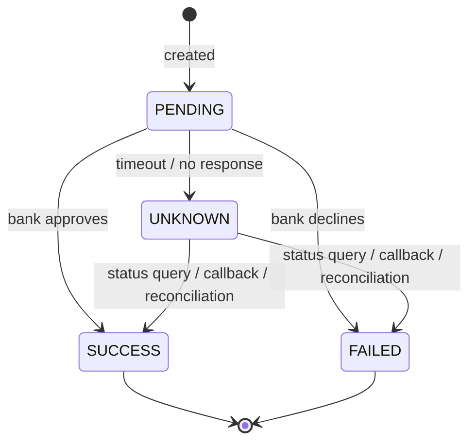
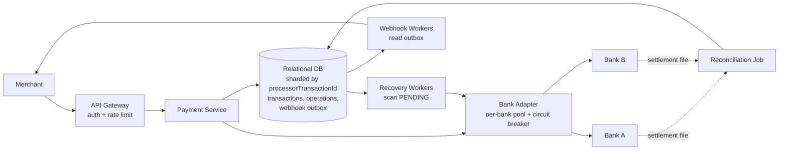
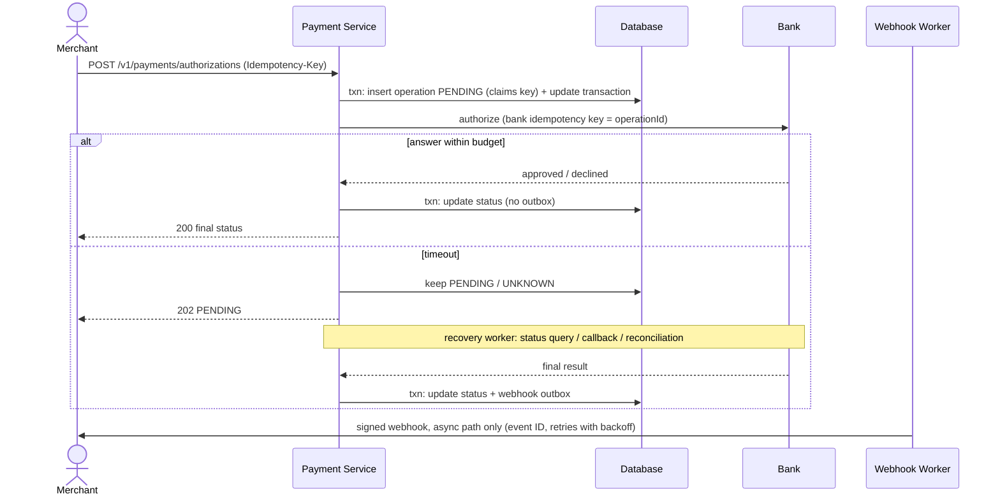
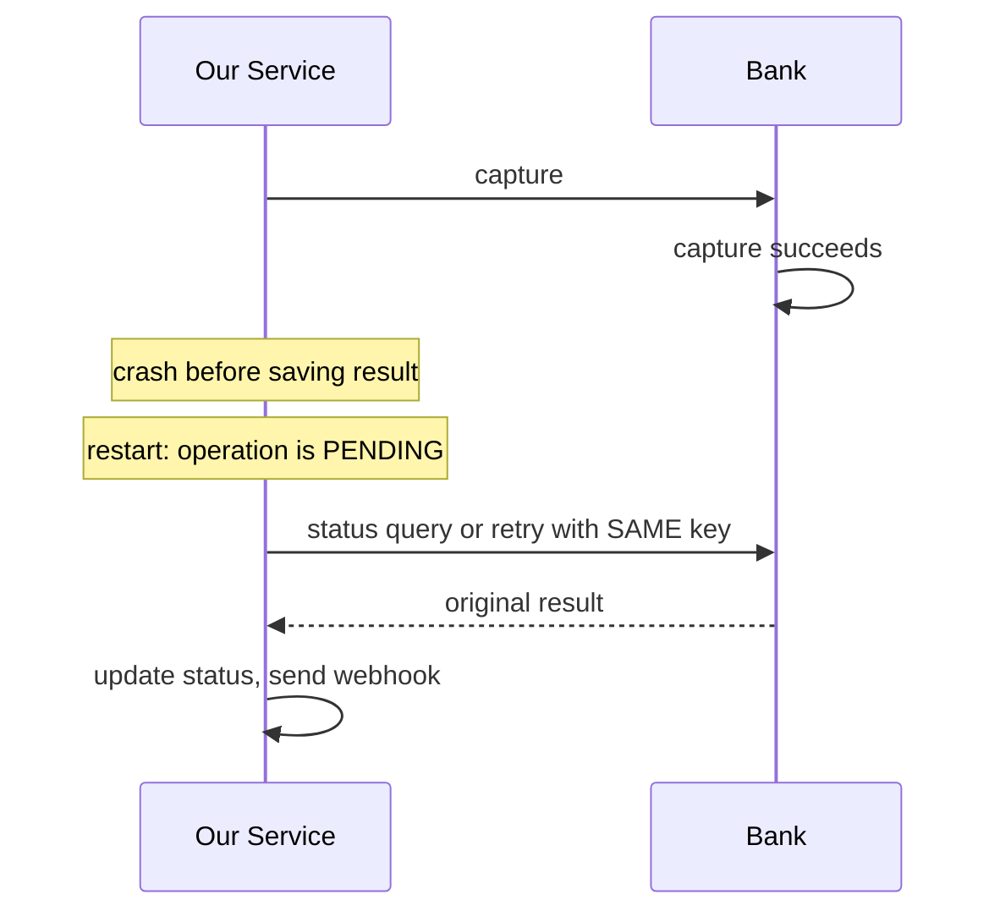

# System Design 面试准备：支付系统（Checkout.com）

基于一次 mock interview 整理。题目：**Design a payment processing system for merchants.**
全英文面试，所以口述稿用英文（口语写法，句子短，方便复述），解释用中文。

**快速入口：** 时间紧只看 [0.3 一条主线](#03-一条主线7-个词记住整个设计) 和 [0.4 必背口语卡](#04-必背口语卡top-15)；想先看追问点看 [13. 面试官可能追问的地方](#13-面试官可能追问的地方按面试进程)。

## 目录

- [0. 使用指南与必背口语卡](#0-使用指南与必背口语卡)
  - [0.1 怎么用这份文档](#01-怎么用这份文档)
  - [0.2 重要度标记](#02-重要度标记)
  - [0.3 一条主线：7 个词记住整个设计](#03-一条主线7-个词记住整个设计)
  - [0.4 必背口语卡（Top 15）](#04-必背口语卡top-15)
  - [0.5 复述训练方法](#05-复述训练方法)
- [1. 开场框架](#1-开场框架)
- [2. Clarify 问题清单](#2-clarify-问题清单)
- [3. 估算](#3-估算)
- [4. API 与数据模型](#4-api-与数据模型)
  - [4.1 生命周期与 ID](#41-生命周期与-id)
  - [4.2 Authorization](#42-authorization)
  - [4.3 Capture](#43-capture)
  - [4.4 Refund](#44-refund)
  - [4.5 查询与通用](#45-查询与通用)
  - [4.6 完整例子：£10.00 的订单](#46-完整例子1000-的订单)
  - [4.7 面试时怎么讲 API](#47-面试时怎么讲-api)
  - [数据模型](#数据模型)
  - [Tables in English](#tables-in-english)
  - [状态机](#状态机)
- [5. 核心流程（6 步）](#5-核心流程6-步)
  - [第 1 步：接收请求](#第-1-步接收请求)
  - [第 2 步：幂等检查](#第-2-步幂等检查)
  - [第 3 步：先落库（operation = key + PENDING）](#第-3-步先落库operation--key--pending)
  - [第 4–5 步：调用银行和处理结果](#第-45-步调用银行和处理结果)
  - [第 6 步：通知商户](#第-6-步通知商户)
  - [退款：并发时防止多退](#退款并发时防止多退)
- [6. Deep dive 主题](#6-deep-dive-主题)
  - [6.1 银行路由与切换](#61-银行路由与切换)
  - [6.2 慢银行隔离（Bulkhead + Circuit Breaker）](#62-慢银行隔离bulkhead--circuit-breaker)
  - [6.3 商户限流与多租户](#63-商户限流与多租户)
  - [6.4 数据库扩展](#64-数据库扩展)
  - [6.5 监控与告警](#65-监控与告警)
  - [6.6 对账（Reconciliation）](#66-对账reconciliation)
  - [6.7 安全与 PCI-DSS](#67-安全与-pci-dss)
  - [6.8 备份与灾备（Disaster Recovery）](#68-备份与灾备disaster-recovery)
  - [6.9 Chargeback、争议与账本](#69-chargeback争议与账本)
- [7. 架构图](#7-架构图)
- [8. 一分钟总结稿](#8-一分钟总结稿)
- [9. 追问与答案](#9-追问与答案)
- [10. 你的经验怎么接](#10-你的经验怎么接)
- [11. 常用英文表达](#11-常用英文表达)
- [12. 易错点与待补](#12-易错点与待补)
- [13. 面试官可能追问的地方（按面试进程）](#13-面试官可能追问的地方按面试进程)
  - [13.1 开场阶段：看你有没有先问清楚](#131-开场阶段看你有没有先问清楚)
  - [13.2 核心流程：最容易被深挖的地方](#132-核心流程最容易被深挖的地方)
  - [13.3 深入阶段：规模、可靠性、运维](#133-深入阶段规模可靠性运维)
  - [13.4 Checkout.com 面经里点名的主题](#134-checkoutcom-面经里点名的主题)
  - [13.5 容易被问到但文档较薄的主题（补充要点）](#135-容易被问到但文档较薄的主题补充要点)
  - [13.6 反向提问：面试官问"你有什么问题"](#136-反向提问面试官问你有什么问题)
  - [13.7 面试时的节奏提示](#137-面试时的节奏提示)

---

## 0. 使用指南与必背口语卡

### 0.1 怎么用这份文档

建议分 4 遍准备，每遍有不同目标：

| 遍数 | 目标 | 读哪里 | 做法 |
| --- | --- | --- | --- |
| 第 1 遍：看懂 | 理解整条主线，知道每个设计"为什么" | 1 → 5，再看 7 的图 | 每节读完，合上文档，用中文把"做什么、为什么、出故障怎么办"讲一遍 |
| 第 2 遍：能说 | 用英文口语讲出来 | 0.4 口语卡 + 每节里的英文引用块 | 对着关键词出声讲，不背原文，卡住了再看 |
| 第 3 遍：能扛追问 | 回答追问并说出取舍 | 6、9、13 | 遮住答案，看问题，自己答，再对照 |
| 第 4 遍：模拟 | 像真实面试一样完整走一遍 | 1 的节奏 + 13.7 | 找人或让我扮演面试官，计时 45 分钟 |

### 0.2 重要度标记

| 标记 | 含义 | 包括 |
| --- | --- | --- |
| ⭐⭐⭐ 必须能脱稿讲 | 几乎一定被问，而且会深挖 | 5（幂等、先落库、超时 = 未知、退款并发、webhook）、6.1、6.2、6.6、9 里的超时与幂等 |
| ⭐⭐ 要能清楚回答 | 大概率被问 | 3 估算、4 API 与数据模型、6.3、6.4、6.5、6.7、6.8 |
| ⭐ 了解，会简述 | 追问时才会到 | 6.9 chargeback 和账本、13.5 中的 3DS、风控、多币种、GDPR 等 |

### 0.3 一条主线：7 个词记住整个设计

```text
Claim → Save → Call → Unknown → Recover → Notify → Reconcile
占位     先落库   调银行   超时=未知   恢复      通知商户    对账兜底
```

| 词 | 一句话（口语） |
| --- | --- |
| Claim | The idempotency key claims the request, so only one copy gets through. |
| Save | Save the operation as pending before we call the bank. |
| Call | Call the bank with the same key every time, and a short timeout. |
| Unknown | A timeout means unknown, not failed. |
| Recover | A worker checks with the bank and finishes the job. |
| Notify | Return the result, or pending plus a webhook, saved together with the status. |
| Reconcile | Every day, compare with the bank's file. It's the last safety net. |

任何追问，都先想想落在这 7 个词的哪一个，再回答。

### 0.4 必背口语卡（Top 15）

用法：先看问题和关键词，自己口述一遍，再对照答案。答案是口语写法，句子短，可以直接用。

**Q1. Which matters more, availability or correctness?**
关键词：correctness first, never charge twice, reject rather than risk
> "Correctness comes first. We must never charge a customer twice or lose a payment. If something breaks, I'd rather reject a request than risk a wrong charge. Availability matters too, but it comes second."

**Q2. What's the difference between authorization and capture?**
关键词：hold vs take, capture refers to auth ID
> "Authorization checks the card and holds the money. It doesn't take it yet. Capture is when we actually take the money. So you can authorize at checkout and capture later, for example when the order ships. Capture and refund both use the ID we created at authorization."

**Q3. The bank times out. What does the merchant see?**
关键词：unknown, pending, 202, never "failed"
> "A timeout means we don't know. The bank may have processed it. So we don't say it failed. We return the transaction ID with a pending status, HTTP 202. The merchant can check with a GET or wait for a webhook. We find out the real result by asking the bank, or from a callback, or from reconciliation."

**Q4. How do you stop a retry from charging twice?**
关键词：idempotency key, unique constraint, bank key, request hash
> "Every request has an idempotency key. We save it with the merchant ID and the operation type under a unique constraint. If the same request comes again, we return the saved result. If the same key comes with a different body, we reject it with a 422. We also send the bank a stable idempotency key, so even our own retries can't charge twice."

**Q5. What if your service crashes right after calling the bank?**
关键词：pending row is the task, recovery worker, status query first
> "That's why we save first. Before calling the bank, we write the operation as pending. If we crash, the pending row is still there. A recovery worker finds old pending rows, asks the bank what happened, and then finishes the job. And because the bank call has a stable key, a retry can't charge twice."

**Q6. The database unique key already stops duplicates. Why do you need more?**
关键词：only protects us, not the bank
> "The unique key only protects our own system. It can't protect the bank. Say the bank takes the money and we crash before saving the result. Our database says pending, but the money is gone. So we also need the bank idempotency key, the pending state, and a way to recover: status query, callback or reconciliation."

**Q7. Two refunds arrive at the same time. What happens?**
关键词：lock the row, reserve, commit, then call bank
> "Say £100 was captured and two £70 refunds come in. In a short transaction, we lock the transaction row and check what's left: captured, minus refunded, minus pending. The first one reserves £70, and the second one is rejected, because only £30 is left. We commit before calling the bank, and we keep the reservation while the result is unknown."

**Q8. Why not hold a database transaction while you call the bank?**
关键词：long lock, can't roll back the bank
> "Two reasons. A long transaction holds a connection and locks while we wait for the bank. And the bank call can't be rolled back with the database anyway. So we use short transactions: save the intent first, call the bank, then save the result."

**Q9. How does the merchant get the result? What about webhooks?**
关键词：sync first, webhook only if pending, outbox, at-least-once, dedupe
> "If the bank answers in time, we just return the result. If not, we return pending, and send a webhook later. We save the status change and the webhook event in the same transaction, so we never lose a notification. A worker sends it with a signature, and retries with backoff. Delivery is at least once, so each event has an ID, and the merchant dedupes. The merchant can also call GET any time."

**Q10. Can you switch to another bank when one fails?**
关键词：clearly down yes, unknown no
> "If the bank is clearly down, yes. We route to another bank before we send. But if a request timed out, we don't know whether the first bank processed it. We don't send it to a second bank. We keep it pending and find out first. Otherwise the customer could be charged twice."

**Q11. One bank is very slow. What do you do?**
关键词：bulkhead, short timeout, circuit breaker, pending
> "Each bank has its own connection pool and a short timeout, so one slow bank can't use up everything. If it keeps failing, a circuit breaker stops sending for a while, and tests it again later. Payments that can't finish become pending, and we sort them out later. Other banks aren't affected."

**Q12. How do you scale the database? What about one huge merchant?**
关键词：shard by transaction ID, not merchant, local transaction, read store
> "We shard by transaction ID, not by merchant. If we sharded by merchant, a big merchant would make a hot shard. With transaction ID, even one huge merchant spreads across all shards, and each payment stays on one shard, so the refund check is a local transaction. The cost is that merchant-level queries cross shards, so we serve those from a read store. Traffic spikes are handled by per-merchant rate limits at the gateway."

**Q13. How do you know the numbers are right?**
关键词：daily reconciliation, settlement file, exceptions, never edit
> "Reconciliation. Every day we compare the bank's settlement file with our records, payment by payment. If a payment is stuck in pending, the bank file tells us the truth. Mismatches become exceptions for people to check. We never edit old records. We add a correcting entry, so there's an audit trail."

**Q14. How do you protect card data?**
关键词：vault, token, last four, encrypt, never log
> "We keep card data out of our system. A separate vault stores the card and gives us a token. Everything else only sees the token or the last four digits. Data is encrypted in transit and at rest, and we never log card numbers. Merchants authenticate with API keys, and our webhooks are signed."

**Q15. What happens if a whole region goes down?**
关键词：multi-AZ sync, cross-region async, RPO/RTO, pending + reconcile, restore drills
> "Inside a region, we run across multiple availability zones with synchronous replication, so one failure doesn't lose a committed payment. We also replicate to another region, and we have a clear RPO and RTO. Payments that were in flight during the failover stay pending, and we check them with the bank and with reconciliation. And we test restores regularly, because a backup you've never restored isn't a backup."

### 0.5 复述训练方法

1. **关键词出声讲**：只看每张卡的"关键词"，用自己的话讲 30 秒，不要背原文。
2. **录音回听**：看有没有冗长、停顿、重复。
3. **三层深度**：每个主题都准备 10 秒版（一句话）、30 秒版（上面的卡）、2 分钟版（对应章节的完整引用块）。面试官追问就往下一层展开。
4. **先结论，后原因**：开口先说结论（"A timeout means unknown"），再解释，不要从背景讲起。
5. **每个设计说取舍**：说完"怎么做"，接一句"The trade-off is …"。

---

## 1. 开场框架

每道题都按这 6 步走，约 45 分钟：

| 步骤 | 时间 | 做什么 |
| --- | --- | --- |
| 1. Clarify | 3–5 分钟 | 功能、规模、一致性、可用性 |
| 2. 估算 | 3 分钟 | QPS、存储 |
| 3. API 与数据模型 | 5–8 分钟 | 接口、表、状态机 |
| 4. High-level 架构 | 5 分钟 | 画图，讲主流程 |
| 5. Deep dive | 15–20 分钟 | 幂等、超时、一致性、故障 |
| 6. 监控与扩展 | 5 分钟 | 指标、告警、分库、容灾 |

开场第一句：

> "Let me start by asking a few questions. Then I'll do a quick estimate, design the API and the data model, draw the main flow, and go deep on the hard parts."

**支付系统开场就要说明优先级：**

> "For a payment system, **correctness comes first**. We must never charge a customer twice, and we must never lose a payment. If something breaks, I'd rather reject a request than risk a wrong charge. Availability and speed matter too, but they come second."

---

## 2. Clarify 问题清单

### 要问的问题

| 类别 | 问题 |
| --- | --- |
| 范围 | 有哪些操作？authorization、capture、refund？哪些不在范围内（风控、结算、卡数据存储）？ |
| 外部依赖 | 对接多少个银行或卡组织？各自的 API 有什么能力（有没有幂等键、状态查询）？ |
| 规模 | 平均 QPS 和峰值 QPS？是所有商户的总量吗？商户分布是否不均？ |
| 延迟 | 商户期望的响应时间？ |
| 币种 | 单币种还是多币种？ |
| 租户 | 多租户吗？ |

### 这次 mock 得到的答案

- 银行：约 10 个，未来 30–50 个；各自 API、延迟、故障行为不同。
- 范围内：authorization、capture、refund；对商户的 API；内部支付状态；银行集成。
- 范围外：风控、商户接入、UI、结算与打款、卡数据存储和 PCI（假设有 vault 服务提供 token）。
- 规模：平均 1,000 笔/秒，峰值 5,000 笔/秒，是所有商户的总量。
- 流量不均：少数大商户占大部分，大商户做促销时会突发。
- 延迟：大多数请求 2–3 秒内返回。
- 币种：单币种，多币种暂不考虑。
- 多租户：是。

### 功能需求（白板上这样写）

1. 商户 API：三个操作，**authorization**（验卡并预留额度）、**capture**（真正扣款）、**refund**（退款）。capture 和 refund 都引用 authorization 时生成的 `processorTransactionId`。
2. 跟踪每笔支付和每个操作的状态。
3. 与银行交互，处理失败和超时。
4. 状态变化时通知商户（webhook），也支持查询。

### 非功能需求

1. **Correctness**：不重复扣款，不丢失支付，账务可审计。
2. **Reliability / Availability**：银行故障不拖垮整个系统。
3. **Latency**：多数请求 2–3 秒内返回。
4. **Throughput**：平均 1,000，峰值 5,000 笔/秒。
5. **Observability**：指标、监控、告警、可追踪。
6. **Security**：认证、签名、不记录卡数据。

---

## 3. 估算

| 项目 | 计算 | 结果 |
| --- | --- | --- |
| 每天笔数 | 1,000 × 60 × 60 × 24 | 约 86.4 million |
| 每条记录大小 | 假设 1 KB（请求体、状态、引用） | 1 KB |
| 每天存储 | 86.4M × 1 KB | 约 86 GB |
| 每年存储 | 86 GB × 365 | 约 30 TB |
| 峰值写入 | 5,000 笔/秒，每笔含 operation 插入、状态更新、transaction 更新、状态历史，约 3–5 次写（webhook 事件只有异步结果才有） | 约 15,000–25,000 次写/秒 |

**易错点：** 86.4M × 10 KB × 365 约等于 300 TB，不是 300 GB。先用 1 KB，说出假设再讲。

**数据保留：** 不能随便删。要考虑监管、争议和 chargeback，保留到 chargeback 期限之后。热数据放关系型数据库，旧数据归档到更便宜的存储，但仍然可查。

---

## 4. API 与数据模型

### 4.1 生命周期与 ID

一笔付款分三个操作，**用同一个 `processorTransactionId` 串起来**：

```text
Authorization ──▶ Capture ──▶ Refund
创建这个 ID        引用它       引用它
```

| | Authorization | Capture | Refund |
| --- | --- | --- | --- |
| 作用 | 验卡，向发卡行预留额度，**不扣款** | 真正扣款 | 退款 |
| 和 ID 的关系 | **创建** `processorTransactionId` | 引用它 | 引用它 |
| 参数 | 卡信息、金额、币种（最多，因为要让发卡行判断） | 金额、币种（必须等于授权额），其余都在 auth 里 | 金额、币种，可部分、可多次 |

| ID | 谁生成 | 用途 |
| --- | --- | --- |
| `processorTransactionId` | 我们，在 auth 时生成，只出现在响应里 | 商户用它引用这笔交易（capture、refund、查询） |
| `operationId` | 我们，每次 API 调用生成 | 标识一次操作；同时作为银行幂等键 |
| `merchantReference` | 商户（可选） | 商户自己的订单号，方便对账，不能代替 ID |
| `Idempotency-Key`（请求头） | 商户 | 防重复提交，每个请求一个 |
| 银行引用 | 银行 | 只保存在内部，auth 的引用供 capture 使用 |

**范围：** auth → capture → refund，不含 void，不含“auth + capture 一步完成”。

### 4.2 Authorization

验卡并预留额度，不扣款。

**Request**

```http
POST /v1/payments/authorizations
Idempotency-Key: auth-order-100-1
```

```json
{
  "card": { "token": "tok_abc123" },
  "amount": 1000,
  "currency": "GBP",
  "merchantReference": "order_100"
}
```

| 字段 | 必填 | 说明 |
| --- | --- | --- |
| `Idempotency-Key`（请求头） | 是 | 防重复提交 |
| `card.token` | 是 | 卡信息。vault 服务生成 token，不传完整卡号（PCI 不在范围内） |
| `amount` | 是 | 最小货币单位（pence），避免浮点 |
| `currency` | 是 | 币种 |
| `merchantReference` | 否 | 商户订单号，方便对账 |

最小版本，生产环境还会有 customer、billingAddress、3DS、descriptor、metadata 等，这里为聚焦核心流程省略。`processorTransactionId` 不在请求里，由我们生成。

**Response**

```json
{
  "processorTransactionId": "ptx_789",
  "operationId": "op_001",
  "status": "AUTHORIZED",
  "amount": 1000,
  "currency": "GBP"
}
```

| status | HTTP | 说明 |
| --- | --- | --- |
| `AUTHORIZED` | 200 | 批准，可以 capture |
| `DECLINED` | 402 | 发卡行拒绝；响应体仍有 `processorTransactionId`、`errorCode`、`retryable` |
| `PENDING` | 202 | 超时或未知；**仍然返回 `processorTransactionId`**，商户用 GET 查询并等 webhook |
| 请求不合法 | 400 / 422 | 缺字段、金额非法、同一个 key 带了不同内容 |

DECLINED 示例：

```json
{
  "processorTransactionId": "ptx_790",
  "operationId": "op_010",
  "status": "DECLINED",
  "errorCode": "INSUFFICIENT_FUNDS",
  "retryable": false
}
```

**设计说明：**

- 被拒的 auth 也生成 `processorTransactionId`，因为它是要审计和对账的记录，但不能被 capture。
- 402 和 400/422 要区分：402 是“请求合法，但发卡行不同意”；400/422 是请求本身有问题。
- 商户不能对 402 自动重试。`retryable` 区分软拒绝（可换卡再试）和硬拒绝（如被盗卡，不应再试）。
- 同一个幂等键重放，返回同一个 402 结果，不会再次调用银行。
- 状态码可能被客户端或代理区别对待，所以靠 `errorCode` 和 `retryable` 说明，不要只看状态码。

> "When the issuer declines, I return 402 with the transaction ID and a clear error code. That way the merchant can tell a declined card from a bad request. A declined auth still gets an ID, because we need it for audit and reconciliation."

若面试官问“为什么不用 200”：

> "Both work. Some APIs return 200 with a declined status, because a decline is a normal business result. I picked 4xx so a client can't mistake a decline for a success. The body has the same details either way."

**内部流程：** 走核心流程 6 步：生成 `processorTransactionId` 和 `operationId` → 写 operation 记录 → 用 `operationId` 作为银行幂等键调用银行授权 → 保存银行返回的授权引用（供 capture 使用）。

### 4.3 Capture

从已预留的额度里真正扣款。**只支持对一个 auth 做一次全额 capture。**

卡和金额币种已在 auth 里，capture 只需要说“扣多少”，并用 `processorTransactionId` 找到对应的 auth。

**Request**

```http
POST /v1/payments/ptx_789/captures
Idempotency-Key: capture-order-100-1
```

```json
{
  "amount": 1000,
  "currency": "GBP",
  "merchantReference": "order_100"
}
```

| 字段 | 必填 | 说明 |
| --- | --- | --- |
| `processorTransactionId`（路径） | 是 | auth 响应里拿到的 ID |
| `Idempotency-Key`（请求头） | 是 | 防重复 capture |
| `amount` | 是 | **必须等于授权额**；必填是为了让商户明确确认金额，防止传错 |
| `currency` | 是 | 必须和 auth 一致 |
| `merchantReference` | 否 | 商户订单号，方便对账 |

**Response**

```json
{
  "processorTransactionId": "ptx_789",
  "operationId": "op_002",
  "status": "CAPTURED",
  "amount": 1000,
  "currency": "GBP"
}
```

| status | HTTP | 说明 |
| --- | --- | --- |
| `CAPTURED` | 200 | 已确认扣款 |
| `PENDING` | 202 | 未知，等恢复或 webhook；保持 CAPTURING，不能被再次 capture |
| `FAILED` | 402 | 银行明确拒绝（沿用 auth 的做法） |

**本地校验（先于银行调用）：**

| 情况 | HTTP | errorCode |
| --- | --- | --- |
| `processorTransactionId` 不存在或不属于该商户 | 404 | `TRANSACTION_NOT_FOUND` |
| auth 不是 AUTHORIZED（被拒、已过期） | 409 | `AUTHORIZATION_NOT_CAPTURABLE` |
| 已经 capture 过（用了不同的 key） | 409 | `ALREADY_CAPTURED` |
| 金额不等于授权额，或币种不一致 | 422 | `AMOUNT_MISMATCH` / `CURRENCY_MISMATCH` |
| 同一个 key 带了不同内容 | 422 | `IDEMPOTENCY_KEY_REUSED` |

**并发控制：** 条件更新 `UPDATE ... SET status='CAPTURING' WHERE status='AUTHORIZED'`。两个并发的 capture（不同 key）只有一个能更新成功，所以不需要金额预留；另一个得到 409 `CAPTURE_IN_PROGRESS`（正在 capture）或 `ALREADY_CAPTURED`。银行**明确拒绝**时，状态改回 AUTHORIZED，商户可以用新 key 重试；结果未知时保持 CAPTURING。同一个 key 的重复请求由幂等记录处理，返回已有结果。

**内部流程：** 走核心流程 6 步。调用银行时带上 auth 时保存的**银行授权引用**，用 capture 自己的 `operationId` 作为银行幂等键，保存银行返回的 capture 引用（供 refund 使用）。

> "Capture only needs the transaction ID, the amount and the currency. The card is already on the authorization. We allow one full capture per authorization, so the amount has to match. And two captures can't both win: we move the authorization from AUTHORIZED to CAPTURING with a conditional update, and only one gets through."

### 4.4 Refund

把已扣的钱退回给持卡人。引用 `processorTransactionId`。因为 capture 只能一次全额，所以**可退总额 = 授权额（已 capture 金额）**。支持**部分退款，可多次**，累计不超过已 capture 金额。

**Request**

```http
POST /v1/payments/ptx_789/refunds
Idempotency-Key: refund-order-100-1
```

```json
{
  "amount": 700,
  "currency": "GBP",
  "merchantReference": "order_100"
}
```

| 字段 | 必填 | 说明 |
| --- | --- | --- |
| `processorTransactionId`（路径） | 是 | auth 响应里的 ID |
| `Idempotency-Key`（请求头） | 是 | 防重复退款 |
| `amount` | 是 | 要退多少；不能超过剩余可退金额 |
| `currency` | 是 | 必须和原交易一致 |
| `merchantReference` | 否 | 商户订单号，方便对账 |

**Response**

```json
{
  "processorTransactionId": "ptx_789",
  "operationId": "op_003",
  "status": "REFUNDED",
  "amount": 700,
  "currency": "GBP",
  "refundableAmount": 300
}
```

`refundableAmount` 是这次退款之后还剩多少可退。

| status | HTTP | 说明 |
| --- | --- | --- |
| `REFUNDED` | 200 | 银行确认退款 |
| `PENDING` | 202 | 未知，保持预留，等恢复或 webhook |
| `FAILED` | 402 | 银行明确拒绝，预留释放 |

**本地校验：**

| 情况 | HTTP | errorCode |
| --- | --- | --- |
| 交易不存在 | 404 | `TRANSACTION_NOT_FOUND` |
| 还没有成功的 capture | 409 | `NOTHING_TO_REFUND` |
| 超过剩余可退金额 | 422 | `AMOUNT_EXCEEDS_REFUNDABLE` |
| 币种不一致 | 422 | `CURRENCY_MISMATCH` |
| 同一个 key 带了不同内容 | 422 | `IDEMPOTENCY_KEY_REUSED` |

**并发控制（和 capture 不同）：** 退款可以多次、部分，所以不能只靠状态条件更新，要用**金额预留**：在短事务里锁住 transaction 行（`SELECT ... FOR UPDATE`），检查 `captured_amount − refunded_amount − refund_pending_amount ≥ 本次金额`，把 `refund_pending_amount` 加上本次金额，同事务写入 key 和 refund operation（PENDING），提交后再调银行。预留不需要单独的表：transaction 上的计数器加上 PENDING 的 refund operation 就是预留。成功时 pending 转入 refunded；明确失败时 pending 减回；结果未知时不能释放。详见第 5 节“退款：并发时防止多退”。

**内部流程：** 走核心流程 6 步。调用银行时带上 capture 保存的**银行 capture 引用**，用 refund 自己的 `operationId` 作为银行幂等键。

> "Refund needs the transaction ID, an amount and a currency. Partial refunds are fine, and you can do many, up to the captured amount. Two refunds can come in at the same time. So before we call the bank, we reserve the amount in a short database transaction."

### 4.5 查询与通用

```http
GET /v1/payments/{processorTransactionId}
```

返回交易当前状态和它所有的操作（auth、capture、refund 及各自的状态和金额）。商户收到 202 PENDING，或 webhook 丢了，靠它拿最新状态。

商户身份来自 API key 或 OAuth token，在 API gateway 认证，不从请求体里取。

### 4.6 完整例子：£10.00 的订单

```text
1. POST /v1/payments/authorizations   amount=1000
   → 200 AUTHORIZED, processorTransactionId = ptx_789

2. POST /v1/payments/ptx_789/captures amount=1000
   → 200 CAPTURED

3. POST /v1/payments/ptx_789/refunds  amount=700
   → 200 REFUNDED, refundableAmount = 300

4. POST /v1/payments/ptx_789/refunds  amount=700 （新 key）
   → 422 AMOUNT_EXCEEDS_REFUNDABLE（只剩 300）
```

每一步在我们内部：写一条 operation 记录 → 用 `operationId` 作为银行幂等键调用银行 → 保存银行引用。**capture 用 auth 的银行授权引用，refund 用 capture 的银行引用。**

### 4.7 面试时怎么讲 API

> "There are three operations. Authorization checks the card and holds the money, but it doesn't take it. It creates a transaction ID and returns it. Capture and refund use that ID in the path, because the card data is already on the authorization.
>
> Capture is one full capture per authorization, so the amount must match. Refund can be partial and repeated, up to the captured amount, so we reserve the amount before calling the bank.
>
> Every call is its own operation with its own idempotency key. We also use the operation ID as the bank's idempotency key. For capture and refund, we send the bank the reference it gave us earlier."

**通用 HTTP 状态：**

| HTTP 状态 | 含义 |
| --- | --- |
| 200 | 已有最终结果 |
| 202 | 已接受，处理中（PENDING） |
| 400 / 422 | 请求内容错误；同一个 key 带了不同内容 |
| 401 / 403 | 认证或权限 |
| 402 | 发卡行或银行拒绝 |
| 429 | 超过限流，带 Retry-After |

### 数据模型

```text
transaction                     （一个 processorTransactionId 一条，从 auth 开始）
  processor_transaction_id, merchant_id, currency, authorized_amount,
  captured_amount, refunded_amount, refund_pending_amount,
  status, auth_expires_at,
  bank_auth_reference, bank_capture_reference, created_at

operation                       （每次 authorize / capture / refund 一条，同时承担幂等）
  operation_id, processor_transaction_id, type, amount, currency,
  status, bank_id, bank_reference, bank_idempotency_key,
  merchant_id, idempotency_key, request_hash, response,
  created_at, updated_at
  UNIQUE (merchant_id, type, idempotency_key)

webhook_outbox                  （仅异步结果的 webhook 事件）
  event_id, merchant_id, processor_transaction_id, operation_id,
  type, payload, status, attempts, next_attempt_at, created_at, sent_at
```

### Tables in English

Three core tables, plus an optional audit table. There is no separate idempotency table: each merchant key maps to exactly one operation, so the key lives on the operation row.

| Table | One row is... | Purpose |
| --- | --- | --- |
| `transaction` | One `processorTransactionId`, created at authorization | The **current state** of a payment. Holds the status and the amount counters (`authorized_amount`, `captured_amount`, `refunded_amount`, `refund_pending_amount`) and the bank references from auth and capture. It is mutable, and it is the lock point: concurrent captures use a conditional status update, and concurrent refunds lock this row to check and reserve the refundable balance. |
| `operation` | One authorize, capture or refund call | The **record of what we were asked to do**, with its type, amount, status (PENDING / UNKNOWN / SUCCESS / FAILED), bank idempotency key and bank reference. It also does idempotency: the unique constraint on `(merchant_id, type, idempotency_key)` lets only one request claim the key, `request_hash` detects the same key with a different body, and `response` is replayed on a duplicate. A PENDING row is the task itself: if we crash, the recovery worker scans old PENDING rows, asks the bank for the real status, and continues. Foreign key: `processor_transaction_id` → `transaction`. |
| `webhook_outbox` | One webhook event for a merchant | Used only when the merchant did not get the final result in the response (we returned pending, and the result came later). Written in the same transaction as the final status, so a result is never saved without its notification. A worker delivers it with a signature and retries with backoff; `status`, `attempts` and `next_attempt_at` track delivery. Foreign keys: `operation_id`, `processor_transaction_id`. |

Optional: `operation_status_history` is append-only (insert only): operation ID, from status, to status, reason, time. The operation's identity and amounts never change, but its `status` is updated in place with a conditional update, so only valid transitions are allowed. The history table keeps the full trail for audit and debugging without making the hot path more complex.

How they work together:

```text
Request      → operation (PENDING, claims the idempotency key)    one transaction
               + transaction (auth: insert AUTHORIZING; capture: AUTHORIZED→CAPTURING;
                 refund: refund_pending_amount += amount)
Call bank
Result       → operation (SUCCESS / FAILED) + transaction counters/status
               + webhook_outbox, only if the merchant already got a pending response
                                                                   one transaction
```

Notes:

- Foreign keys are logical (enforced by code, no database constraint), and only hold inside one shard.
- **Shard routing:** capture and refund route by the shard encoded in `processorTransactionId`. Authorization has no ID yet, so route by `hash(merchant_id, idempotency_key)` and generate the ID on that shard, with the shard number inside it. Then a retry of the same auth key always reaches the same shard, so the unique constraint works.

要点：

- **transaction 和 operation 分开**：支持多次部分退款，不覆盖历史。
- **预留 = transaction 上的计数器**（`refund_pending_amount`）+ PENDING 的 operation，不需要单独的预留表。
- **transaction 状态**：`AUTHORIZING → AUTHORIZED → CAPTURING → CAPTURED`；auth 被拒为 `DECLINED`；过期为 `EXPIRED`（不用定时任务，capture 时检查 `now > auth_expires_at`，过期则返回 409）；退款只改金额计数，不改状态（全部退完可标 `REFUNDED`）。
- **operation 状态和 API 状态的对应**：operation 内部是 PENDING / UNKNOWN / SUCCESS / FAILED；对外 SUCCESS 显示为 AUTHORIZED / CAPTURED / REFUNDED，FAILED 显示为 DECLINED / FAILED，PENDING 和 UNKNOWN 都显示为 PENDING。
- **幂等放在 operation 上**：一个 key 对应一个 operation，唯一约束 `(merchant_id, type, idempotency_key)` 就是占位。key 只在约定的窗口内（如 24 小时）有效；operation 保留更久，所以超过窗口的 key 不再当作重复。被 400/422 拒绝的请求没有 operation，也就不保存 key。
- **operation 的状态是原地更新**：身份和金额字段不变（类型、金额、币种、幂等 key、请求指纹、银行幂等键），`status`、`bank_reference`、`response`、`updated_at` 会变，用条件更新保证只有合法转换。
- **审计（可选的第四张表）**：每次状态变化再追加一条记录，只插入、不修改，这样热路径保持简单，又有完整历史。

```text
operation_status_history        （可选，仅追加）
  operation_id, from_status, to_status, reason, at
```

  真正严格的追加式是账务（ledger，每笔资金变动一条分录），不在本题范围内。
- **同一 processorTransactionId 的数据在同一个分片**：余额检查在一个本地事务里完成。

### 状态机



说明：PENDING = 已落库，还没有拿到银行答复（包括还没调、正在调）；UNKNOWN = 已发出请求但结果不明。恢复 worker 两种都扫描。

规则：只有明确结果才能进入终态；SUCCESS 和 FAILED 不能再改变；更新用条件 UPDATE（`WHERE status IN ('PENDING', 'UNKNOWN')`）或乐观锁。

---

## 5. 核心流程（6 步）

```text
1. 接收请求   认证商户，限流
2. 幂等检查   数据库唯一键占位，校验请求指纹
3. 先落库     一个事务写 operation（PENDING，带幂等 key）并更新 transaction
4. 调用银行   同一个银行幂等键，短超时
5. 处理结果   成功 / 失败 / 未知
6. 通知商户   同步返回结果，或 pending + webhook
```

每一步回答三件事：做什么、为什么、出故障怎么办。

| 步骤 | 一句话 | 口诀 |
| --- | --- | --- |
| 1 | 认证、限流 | Authenticate, limit |
| 2 | 占位、比对 | Claim → Compare |
| 3 | 先存后调 | Save first, call later |
| 4 | 同 key，短超时 | Same key, short timeout |
| 5 | 超时 = 未知 | Timeout = unknown |
| 6 | 一起存，退避重试 | Save together, retry with backoff |

### 第 1 步：接收请求

- API gateway 认证商户，按商户限流（token bucket）。
- 超限返回 429 和 Retry-After。
- 大商户可按协议提高限额；队列或配额按商户隔离，防止一个商户占满资源。

### 第 2 步：幂等检查

**为什么：** 商户会重试（网络超时、用户连点）。没有幂等，同一笔付款可能被扣两次。

> "Every request carries an idempotency key. We claim the key in our database first. Only one request gets to process it."

唯一键：`(merchant_id, operation_type, idempotency_key)`，并保存 `request_hash`。

| 情况 | 处理 |
| --- | --- |
| 新 key | 第 3 步插入 operation 成功（唯一约束占位），继续处理 |
| 同 key、同内容、已完成 | 返回保存的结果 |
| 同 key、同内容、处理中 | 返回已有 operation ID 和当前状态，不再调用银行 |
| 同 key、不同内容 | 拒绝，返回 422 |

**并发重复：** 第 2 步和第 3 步在实现上是**同一次 insert**：直接插入 operation，成功就是占位成功；唯一约束冲突就是重复，读取已有记录，按上表处理。不要“先查再插”，会有竞态。

**最关键的一点：数据库唯一键只保护我们自己的系统，保护不了银行那一侧。**

```text
我们 ── 调用银行扣款 ──▶ 银行（已扣款成功）
我们 ✗ 崩溃，没保存结果
重启后：数据库里是 PENDING，我们不知道银行有没有扣
```

所以还需要：银行幂等键、PENDING 状态、恢复机制（查询、回调、对账）。

记忆口诀：Claim → Compare → Call → Confirm（占位、比对、调用、确认）。

> "Every request has an idempotency key from the merchant. We save it with the merchant ID, the operation type and a hash of the request. There's a unique constraint on the first three, so if two identical requests come in together, only one gets in. The other one just reads the existing record and returns its status. If the same key comes with a different amount, we reject it. That's a client error.
>
> But the database only protects us. Say the bank takes the payment and we crash before saving the result. That's the gap. So we send the bank a stable idempotency key, we keep the operation as pending, and we recover by status query or reconciliation."

### 第 3 步：先落库（operation = key + PENDING）

**为什么：** 调用银行是外部操作，不能回滚。必须先把“要做什么”持久化。

```text
BEGIN TRANSACTION
  1. 插入 operation 记录，status = PENDING
     （带 merchant_id、idempotency_key、request_hash；唯一约束就是占位）
  2. 更新 transaction（见下表，每种操作不同）
COMMIT
```

| 操作 | 第 2 项对 transaction 做什么 |
| --- | --- |
| authorization | 插入新行，status = `AUTHORIZING` |
| capture | 条件更新 `AUTHORIZED → CAPTURING`，失败则 409 |
| refund | 锁行，检查可退金额，`refund_pending_amount` 加上本次金额，失败则 422 |

这一行 operation 同时解决两个问题；transaction 的更新是为了让并发控制和 operation 同时生效：

| 写什么 | 防什么 |
| --- | --- |
| operation 上的 idempotency key（唯一约束） | 商户重复提交同一个请求 |
| operation 的状态 PENDING（“我要调银行”的意图） | 我们崩溃后，忘了要调银行 |

**PENDING 记录本身就是任务。** 崩溃重启后，恢复 worker 扫描超过一定时间的 PENDING 记录（`status, updated_at` 建索引），用 `SELECT ... FOR UPDATE SKIP LOCKED` 或租约认领，先向银行查询真实状态，再决定重试还是更新结果。只扫描超过同步预算的记录，避免和仍在等银行的请求线程抢；即使抢到，同一个银行幂等键也保证不会重复处理。不需要额外的 outbox 来调度“调银行”。

> outbox 只用在第 6 步的 webhook：最终结果和 webhook 事件要同事务保存，而且投递有自己的重试状态。

**同步优先：** API 提交后直接调银行，2–3 秒内拿到结果就返回；超时转 PENDING，后台继续。同步路径和后台 worker 用同一条 operation 和同一个银行幂等键，绝不各自创建扣款。

**崩溃的 3 个时间点：**

| 崩溃位置 | 数据库里有什么 | 恢复 |
| --- | --- | --- |
| 事务提交前 | 什么都没有 | 商户用同一个 key 重试，按新请求处理 |
| 提交后，调银行前 | PENDING | 恢复 worker 扫到，先查银行状态，再用同一个银行幂等键调用 |
| 调银行后，保存结果前 | PENDING | 恢复 worker 先查银行状态，或用银行幂等键重试，最后对账 |

> "Before we call the bank, we save one operation row as pending, in the same transaction as the transaction update. That row has the merchant's idempotency key under a unique constraint, so the merchant can't submit the same request twice. The pending status is our promise to call the bank, so if we crash, we don't forget. A recovery worker scans old pending rows, asks the bank what really happened, and then carries on. And the bank call uses a stable idempotency key, so a retry can't charge twice."

口诀：Save first, call later. Key + pending. Recover by status.

### 第 4–5 步：调用银行和处理结果

**4 个规则：**

| 规则 | 做法 |
| --- | --- |
| 稳定幂等键 | 用 operation ID 作为银行请求 key，重试时不变 |
| 短超时 | 每个银行单独设置，比整体响应预算短 |
| 隔离 | 每个银行独立连接池和熔断器 |
| 只重试安全的情况 | 见下表 |

**3 种结果：**

| 结果 | 判断 | 状态 | 处理 |
| --- | --- | --- | --- |
| 明确成功 | 银行批准 | SUCCESS | 保存银行引用号，通知商户 |
| 明确失败 | 银行拒绝（余额不足、卡无效） | FAILED | 通知商户，退款则释放预留 |
| 未知 | 超时、断连、5xx、崩溃 | PENDING / UNKNOWN | 退款保持预留，不盲目重试，走恢复 |

> **超时 = 未知，不是失败。**

| 情况 | 能确定银行没处理吗 | 处理 |
| --- | --- | --- |
| 连接建立前失败（DNS、连接被拒） | 能 | 可安全重试或换银行 |
| 银行明确返回拒绝码 | 能（已处理并拒绝） | FAILED |
| 请求已发出，等响应超时 | 不能 | PENDING |
| 5xx 或格式错误 | 不能，看银行文档 | 通常 PENDING |

**恢复未知结果的 3 条路：**

1. 主动查询银行的状态 API。
2. 等银行回调。
3. 兜底：每日对账文件。

恢复 worker 定期扫描超过 N 秒的 PENDING / UNKNOWN：查询银行 → 明确结果就更新并发 webhook → 仍未知则退避重试 → 超过上限转人工。

**如果银行既无幂等键又无状态查询：**

> "We don't resend the capture blindly. We keep the payment pending, tell the merchant it's in progress, and resolve it through the bank's reconciliation file or manual investigation."

**结果落库（同一个事务，三种操作各不同）：**

| 操作 | 银行成功 | 银行明确失败 | 结果未知 |
| --- | --- | --- | --- |
| authorization | operation SUCCESS，transaction → `AUTHORIZED`，保存银行授权引用 | operation FAILED，transaction → `DECLINED` | 保持 `AUTHORIZING` |
| capture | operation SUCCESS，transaction → `CAPTURED`，`captured_amount` 写入，保存 capture 引用 | operation FAILED，transaction 回到 `AUTHORIZED` | 保持 `CAPTURING` |
| refund | operation SUCCESS，`refund_pending_amount` 减、`refunded_amount` 加 | operation FAILED，`refund_pending_amount` 减回 | 保持预留 |

同时把最终响应保存到 operation 的 `response`，之后同一个 key 重放就返回它。

**对商户：** 拿到结果就同步返回；超时则返回 processorTransactionId 和 PENDING（HTTP 202）。**不要**返回“失败，请重试”，商户用新 key 重试会重复扣款。

> "When we call the bank, we always send the same idempotency key for the same operation. So a retry can't create a second charge or refund. Each bank has a short timeout, its own connection pool and a circuit breaker.
>
> There are three results: success, failure or unknown. A timeout is unknown, not a failure, because the bank may have already processed it. So we keep the operation pending, and return the transaction ID with a pending status. We never tell the merchant it failed.
>
> Then a recovery worker checks with the bank, by status query or callback. If the bank can't tell us, the daily reconciliation file gives the final answer."

口诀：Same key, short timeout. Three outcomes. Timeout = unknown. Recover, don't resend.

### 第 6 步：通知商户

- 同步响应：在预算内拿到结果就直接返回最终状态。
- 异步 webhook：只在商户没拿到最终结果时发（已经返回 202 PENDING，之后结果才出来）。同步成功不写 outbox。响应在网络上丢了，商户可以用同一个 key 重试（返回已保存的响应）或 GET 查询。
- 商户也可以随时 `GET /v1/payments/{processorTransactionId}` 查询，作为兜底。

```text
同一个数据库事务（异步路径，即之前已返回 PENDING）：
   更新 operation 状态和 transaction（见第 5 步的结果落库表）
   插入 outbox 事件（stable event_id）
提交

（同步路径：只更新 operation 和 transaction，直接返回，不写 outbox）

Webhook Worker：
   读取事件 → 签名 → POST 到商户 URL
   2xx → 标记已送达
   失败/超时 → 指数退避 + 抖动，稍后重试
   超过重试期限 → 标记失败，告警；商户可查询或请求重放
```

| 设计 | 解决什么问题 |
| --- | --- |
| 状态更新和事件同一个事务 | 不会出现“状态改了但通知丢了” |
| 稳定的 event ID | 重复投递时商户去重 |
| 签名（HMAC + 时间戳） | 商户能验证来源，防篡改和重放 |
| 指数退避 + 抖动 | 商户暂时挂了也不被打垮，避免同时重试 |
| 有限重试窗口 | 不无限重试，超过转告警或人工 |
| 投递记录 | 可查询，可重放 |

保证：至少一次投递。不保证：恰好一次、全局顺序。所以商户用 event ID 去重，必要时回查最新状态。

> "If the bank answers in time, we return the final result right away. If not, we return the transaction ID with a pending status, and send a webhook when the result is final.
>
> We only send a webhook when the merchant didn't get the final result in the response. To make sure it's never lost, we save the status change and an outbox event in the same transaction. A worker sends the signed webhook and retries with exponential backoff and jitter. Delivery is at least once, so every event has a stable ID, and the merchant dedupes by it. Events can arrive out of order, so the merchant can also query the payment for its latest status."

口诀：Save together. Send with signature. Retry with backoff. Merchant dedupes. Query as fallback.

### 退款：并发时防止多退

场景：已 capture £100，两个 £70 的退款，key 不同，同时到达。

> "In a short database transaction, we lock the transaction row and check what's left to refund: captured, minus refunded, minus pending refunds. Then we reserve the £70 and create the refund operation as pending. We commit before calling the bank. The reservation stays while the result is unknown. If the refund succeeds, we finalise it. If the bank clearly says no, we release it."

- 第一个预留 £70（`refund_pending_amount` = 70），剩 £30，第二个 £70 被拒。
- 银行调用超时时**不能**释放预留，因为结果未知。
- 不要在调用银行期间一直持有行锁。

---

## 6. Deep dive 主题

### 6.1 银行路由与切换

| 要点 | 内容 |
| --- | --- |
| 路由规则 | 卡类型、币种、成本、成功率、商户合同 |
| 银行明确宕机 | 快速失败或熔断器打开时，发送前就选另一个银行 |
| **结果未知** | **不发给第二个银行**，保持 PENDING，先弄清楚 |

> "If a bank is clearly down, we route to another one before we send. But if a request timed out and we don't know the result, we don't send it to a second bank. We keep it pending and find out first."

原因：只有确认第一个银行没处理，切换才安全；否则客户可能被两个银行各扣一次。

### 6.2 慢银行隔离（Bulkhead + Circuit Breaker）

> "Each bank gets its own limited resources, so one slow bank can't use up everything. If a bank keeps failing, we stop sending for a while and let it recover. Payments that can't finish become pending, and we sort them out later."

- 每个银行独立连接池和短超时。
- 熔断器：连续失败后暂停发送，半开探测恢复。
- 不要“增加超时一直等”，也不要“立即无限重试”。

### 6.3 商户限流与多租户

> "Every merchant has its own limit at the gateway. If a merchant sends too much, we return 429 and tell them when to retry. Big merchants get higher limits by agreement. This way one merchant can't hurt the others."

- token bucket，按商户。
- 独立队列或配额，避免大商户突发占满容量。
- 所有查询和缓存 key 都带 tenant。
- 限流按合同设置速率和突发额度；上游限流也保护了数据库，一个商户写不了无限多。
- 连接池和 worker 容量按商户分配份额，防止突发饿死恢复 worker 和 webhook worker。

**流量不均和数据不均是两个问题：** 流量靠网关限流，数据分布靠分片键。**不要把同一个商户的交易放进同一个分片。**

> "At the gateway, each merchant has its own rate limit, based on the contract. For the database, I wouldn't shard by merchant, because a big merchant would create a hot shard. We shard by transaction ID, so even one huge merchant spreads across all shards. And each payment and its operations stay on one shard, so the refund balance check is a local transaction. The trade-off is that merchant-level queries cross shards. For those, we use a read store or a secondary index, fed by change data capture. If a merchant needs isolation or data residency, we give it a dedicated shard group through a small directory."

### 6.4 数据库扩展

> "We shard by transaction ID, so a transaction and all its captures and refunds stay together. That makes the refund balance check a single local transaction. We use replicas for reads and reports, and we archive old data to cheaper storage."

| 方案 | 优点 | 缺点 |
| --- | --- | --- |
| 按 processorTransactionId 分片 | 负载均匀，余额检查本地事务 | 按商户查询需要二级索引或单独读库 |
| 按 merchant ID 分片 | 商户查询方便 | 大商户（如占 30% 流量）落在一个分片，成为热点，可能放不下，还要重新分片 |

**为什么不按商户分片：** 我们的工作单位是一笔付款，一笔付款不需要另一笔付款的数据，所以可以按付款打散。大商户的交易会均匀分布到所有分片。

**auth 没有 ID：** 按 `hash(merchant_id, idempotency_key)` 路由，同样能打散大商户的流量，并保证同一个 key 重试落在同一个分片。

**代价和处理：** 按商户的查询（列表、报表、对账）会跨分片。用**二级索引或读库**（搜索索引、读副本、数据仓库），通过 CDC 从主库同步，按商户建键；`GET /payments/{id}` 不受影响，因为分片号在 ID 里。

**什么时候考虑按商户放置：**

- 数据驻留或合规：某些商户的数据必须留在特定区域。
- 超大商户（noisy whale）：用一个小的目录（merchant → shard group）给它**专用分片组**，其他商户仍按哈希分片。这是优化，不是默认。

- 读副本用于读取和报表。
- 旧数据归档但仍可查。
- 关注热点，规划重新均衡。
- 不按时间戳分片（当天写入全落在一个分片）。

### 6.5 监控与告警

> "I'd watch business metrics first: success rate, latency, and how many payments are stuck in pending. I'd split them by bank and by merchant, so we know where the problem is. I'd alert on symptoms, like a sudden drop in success rate. And I'd use a correlation ID to trace one payment across services, without logging card data."

| 类别 | 指标 |
| --- | --- |
| 业务 | 成功率、延迟分位数、PENDING 数量和年龄、webhook 失败（按银行、商户拆分） |
| 银行 | 每个银行的错误率、熔断器状态 |
| 系统 | webhook 积压和最老事件年龄、数据库健康 |
| 追踪 | correlation ID、分布式 tracing |
| 安全 | 日志中不记录卡数据 |

原则：告警基于客户感受到的症状（成功率下降、pending 增长），而不仅是服务器指标。

### 6.6 对账（Reconciliation）

> "Reconciliation is our last safety net. Every day, we compare the bank's settlement file with our records, payment by payment. If a payment is stuck in pending, the bank file tells us the truth. If something doesn't match, we raise it as an exception for people to check. We never edit old records. We add a correcting entry, so there's always an audit trail. And the job itself must be idempotent and restartable, so a crash halfway doesn't break anything."

- 用银行引用号和我们的 operation ID 匹配。
- 比较状态、金额、币种。
- 不一致（一边缺失、金额不同、重复）报为异常，人工调查。
- 账务修正用新的调整记录，不改旧记录。
- 批处理要幂等、可重启。

### 6.7 安全与 PCI-DSS

**PCI-DSS** 是卡组织制定的安全标准：凡是存储、处理、传输卡号的系统都要遵守并定期审计。思路是：**尽量不碰卡数据，范围越小越好。**

> "We keep card data out of our system. A separate vault stores it and gives us a token. Everything else only sees tokens or the last four digits. Data is encrypted in transit and at rest, and we never log card numbers."

| 方面 | 做法 |
| --- | --- |
| 卡数据范围 | 卡号进入独立 vault（PCI 范围小而严格），其他服务只用 token，不在 PCI 范围内 |
| 绝不存储 | CVV 授权后不能存；完整卡号能不存就不存 |
| 展示 | 响应、日志、界面只显示后四位 |
| 传输加密 | 全程 TLS（对商户、对银行） |
| 静态加密 | 数据库和备份加密；密钥放 KMS/HSM，定期轮换，权限分离 |
| 访问控制 | 最小权限；谁访问了敏感数据有审计日志 |
| 商户认证 | API key 或 OAuth，在 API gateway 完成；key 可轮换、可吊销；商户身份不从请求体取 |
| Webhook | 用 HMAC 签名，带时间戳防重放；商户验签 |
| 日志 | 脱敏，不记录卡号和 CVV；correlation ID 追踪 |
| 防滥用 | 按商户限流、请求校验、异常行为告警 |

面试追问：

| 问题 | 答案要点 |
| --- | --- |
| Where is card data stored? | 只在 vault。我们的 transaction 表只存 token、后四位、卡品牌 |
| What if the vault is down? | 新支付无法处理，返回可重试的错误（503）；不能绕过 vault 存卡号。已有 PENDING 的恢复不依赖卡号，因为银行请求里已有 token 或引用 |
| How does a merchant verify a webhook? | 用共享密钥验 HMAC 签名，检查时间戳在窗口内，用 event_id 去重 |
| How do you rotate keys? | 支持新旧两个 key 同时有效一段时间，再下线旧 key，避免中断 |

### 6.8 备份与灾备（Disaster Recovery）

> "For a payment system, correctness comes first. We run across multiple availability zones with synchronous replication, so one failure never loses a committed payment. For a region failure, we replicate to another region and fail over, with a clear RPO and RTO. And we test restores regularly, because a backup you've never restored isn't a backup."

| 概念 | 含义 |
| --- | --- |
| RPO（Recovery Point Objective） | 最多能丢多久的数据。支付接近 0：已提交的交易不能丢 |
| RTO（Recovery Time Objective） | 恢复服务最多要多久 |

| 层面 | 做法 |
| --- | --- |
| 单机或单可用区故障 | 多 AZ 部署；数据库主库同步复制到同城副本，自动切换 |
| 整个 region 故障 | 跨 region 异步复制（有少量 RPO），或同步复制换更高延迟；用对账找回切换窗口内可能缺失的支付 |
| 备份 | 定期全量加增量日志（point-in-time recovery）；备份加密、异地保存 |
| 演练 | 定期恢复演练；故障切换演练 |
| 切换时的正确性 | 切换窗口内状态不确定的支付保持 PENDING，用银行 settlement 文件和对账确认，不盲目重发 |
| 应用层 | 无状态服务，可随时重建；幂等键让商户重试安全 |

面试追问：

| 问题 | 答案要点 |
| --- | --- |
| Sync or async replication across regions? | 同步：不丢数据但延迟高、region 间网络故障会影响写入；异步：快但故障切换可能丢最后几秒。支付优先正确，用同 region 多 AZ 同步，跨 region 异步加对账兜底 |
| How do you know backups work? | 定期恢复到演练环境并校验；监控备份任务 |
| What happens to in-flight payments at failover? | 状态不确定的保持 PENDING，查银行或用对账确认；商户用同一幂等键重试返回已保存的响应 |

### 6.9 Chargeback、争议与账本

**Chargeback（拒付）：** 持卡人向发卡行争议某笔交易，银行把钱先从商户扣回，商户可提交证据申诉。这是数据要保留到 chargeback 期限之后的原因。

```text
持卡人发起争议 -> 发卡行通知（经卡组织）-> 我们收到 chargeback 通知
  -> 创建 dispute 记录，关联原 transaction
  -> 通知商户，商户在期限内提交证据
  -> 提交给银行 / 卡组织
  -> 结果：商户胜诉（资金退回）或败诉（资金扣除）
```

| 要点 | 内容 |
| --- | --- |
| 数据模型 | 单独的 dispute 表，关联 transaction，有自己的状态机和截止时间 |
| 对账影响 | settlement 文件里会出现 chargeback 的资金变动，对账要识别并生成对应调整 |
| 与退款的区别 | 退款是商户发起；chargeback 是持卡人通过银行发起，不受商户控制 |
| 保留证据 | 原始授权、capture、发货证明等要保留到争议期限之后 |

**账本（Ledger）：** 本题范围内不展开，但追问时可以简述：

> "Money movements are recorded in a double-entry ledger. Every movement is an entry with a debit and a credit that balance. Entries are append-only. We never edit them. We fix mistakes with a reversing entry."

- 每笔资金变动（capture、refund、chargeback、手续费）一条分录，借贷平衡。
- 追加式、不可修改，更正用冲销分录，可审计。
- 余额由分录汇总得出，对账用它与银行文件比对。
- 你的会计系统经验（journal type、debit/credit account）可以直接接到这里。

---

## 7. 架构图

### 整体架构



### 一次 authorization 的时序（capture、refund 流程相同）



### 崩溃后丢结果



---

## 8. 一分钟总结稿

> "A merchant sends an authorization, capture or refund with an idempotency key. We save the operation in our database first, with a unique constraint, and then call the bank with the same key. A timeout means pending, not failed. Refunds reserve the amount before calling the bank. If the result comes later, we save the final status and the webhook event together, and workers deliver it with retries. Each bank has its own connection pool and a circuit breaker, and we only switch banks when we know the first one didn't process the request. We shard by transaction ID, and we watch the success rate and how old the pending payments are. And reconciliation with the bank files is our final safety net."

---

## 9. 追问与答案

### 幂等

| 问题 | 答案要点 |
| --- | --- |
| How long do you keep the keys? | 一般 24 小时到几天，超期才允许复用；与商户约定，可配置 |
| DB or Redis for the key? | 以数据库为准（持久、有事务）。Redis 只能做加速，不能作为唯一依据 |
| What if the key is claimed but the service crashes before calling the bank? | 记录是 PENDING，恢复 worker 扫描后先查银行状态再继续，不丢也不重复 |
| Who generates the key? | 商户生成。内部重试时用 operation ID 作为银行幂等键 |
| Is idempotency exactly-once? | 不是。传输至少一次，效果只生效一次 |
| Same key, different body? | 拒绝，返回 422，说明是客户端错误 |

### 超时与一致性

| 问题 | 答案要点 |
| --- | --- |
| Which matters more, availability or correctness? | Correctness。宁可拒绝部分请求，也不能重复扣款或丢失支付 |
| Timeout from the bank, what do you do? | 视为未知，保持 PENDING，不盲目重试；查状态、等回调、对账 |
| What if the bank has no status API? | 不重发 capture；保持 PENDING，用对账文件或人工调查 |
| Can you retry on timeout? | 仅当银行支持幂等键、且用同一个键时才安全 |
| What if a callback arrives before the sync response returns? | 都按 operation ID 更新同一条记录，状态机限制合法转换，更新幂等 |
| Two workers update the same operation? | 条件 UPDATE 或乐观锁，只有一个生效 |
| Why not hold a DB transaction during the bank call? | 长事务占连接和锁；银行调用无法随数据库回滚 |
| Why a webhook outbox instead of sending directly? | 状态更新和发 webhook 是两个系统，不能放进同一事务，中间崩溃会丢通知（双写问题）；outbox 同事务保存，worker 负责重试 |
| Why no outbox for the bank call? | PENDING 的 operation 就是任务；恢复 worker 扫描它，先查银行再继续 |

### 退款与账务

| 问题 | 答案要点 |
| --- | --- |
| Two concurrent refunds? | 短事务里锁 transaction 行，检查 captured − refunded − pending，增加 pending，再调银行；预留直到结果明确才释放 |
| Two concurrent captures? | 条件更新 AUTHORIZED → CAPTURING，只有一个成功 |
| How do you keep an audit trail? | operation 状态原地更新，另有追加式的状态历史表（只插入）；更正用新的调整记录，不改旧记录；对账时用 operation 重算 transaction 的计数器 |
| Partial refunds? | transaction 与 operation 分开，每个 refund 有自己的金额和状态；capture 只支持一次全额 |

### 规模与运维

| 问题 | 答案要点 |
| --- | --- |
| How do you store 30 TB a year? | 按 processorTransactionId 分片，读副本，旧数据归档但可查，保留到 chargeback 期限 |
| What if one merchant floods the system? | 按商户限流，429，独立队列或配额 |
| A bank is slow? | 独立连接池、短超时、熔断器；转 pending，不阻塞其他支付 |
| Switch to another bank on failure? | 仅在确认没处理时；结果未知时不切换 |
| What if the merchant's server is down for hours? | 重试窗口内退避重试；超出后停止并告警，商户恢复后可重放或查询 |
| Webhook order? | 不保证全局顺序；带版本或时间戳；商户可回查最新状态 |
| What do you monitor? | 成功率、延迟、PENDING 数量和年龄、按银行和商户拆分；对症状告警 |
| How do you handle a webhook backlog? | 监控积压和最老事件年龄；水平扩展 webhook worker |
| How do you roll back faulty payment logic? | 功能开关、灰度发布、快速回滚；操作幂等，状态可恢复；用对账修正已发生的错误 |

---

## 10. 你的经验怎么接

以下都需要符合你的真实情况，面试前请自己核对。

### 幂等（第 2 步）

> "In my current team's framework, tasks run at least once, so they must be idempotent. Jobs are identified by a name and a trigger, so a duplicate submission is rejected. That's the same idea as an idempotency key."

对应 TasCreed：`jobName + trigger` 去重，至少一次，所以任务必须幂等。

### 先落库、可恢复（第 3 步）

> "A similar idea exists in our framework: the job and its tasks are saved first in etcd. Workers then pick tasks up. If a worker dies, its claim expires, and another worker takes over. The state is saved first, and the work is recoverable."

### 重试和人工干预（第 4–6 步）

> "I've dealt with retries that go wrong. In my team's framework, I found some threads retrying endlessly. I added exponential backoff, and an API to stop a bad retry loop. Later we built a portal to monitor and stop them. So I know retries need limits, and humans need a way to step in."

在这道题里的对应：

- Exponential backoff 和 jitter：状态查询、webhook 重试。
- Kill 机制：恢复 worker 超过上限转人工，以及运维手动干预。
- Portal：PENDING 监控面板。

### 对账和批处理（6.6）

> "I've worked on this kind of batch processing. In my team's framework, a job is split into shards, and if a node crashes, another node picks up the task. Tasks must be idempotent, which is exactly what reconciliation needs."

### 注意

- 不要说成自己设计了 TasCreed。你的角色：重度使用者，发现问题就主动改基础框架。
- kill 的原理：删除 etcd 上的 adoption，下一次心跳时 Worker 找不到它，Task 被释放。注意这不等于取消 Job，Task 仍是 todo，可能被别的节点重新捡起。详见 `../project-coding-examples/tascreed-story.md`。

---

## 11. 常用英文表达

开场与结构

- Let me clarify the requirements first.
- Let me estimate the scale.
- Let me walk through the main flow, then go deep on the hard parts.
- The trade-off here is …
- I'd start simple and then improve it.

一致性与故障

- Correctness comes first.
- A timeout means unknown, not failed.
- We keep it pending and resolve it later.
- At-least-once delivery, so the consumer must be idempotent.
- Database constraints protect our system, not the external bank.
- The safety net is reconciliation.

设计取舍

- It adds complexity, but it protects us from …
- We can tolerate X, but not Y.
- This isolates the failure to one bank / one merchant.
- We alert on symptoms, not only on server metrics.

反问面试官

- Does the bank support idempotency keys and status queries?
- Is this traffic for all merchants combined?
- Are we in scope for fraud detection and settlement?

口语过渡句（想思路、控制节奏时用）

- Good question. Let me think about that for a second.
- Here's the catch: …
- The tricky part is …
- So the idea is simple: …
- Let me give you the short version first, then the details.
- Let me walk you through what happens step by step.
- That works, but the downside is …
- I'd pick X over Y here, because …
- If we had more time, I'd also look at …
- To sum up: …

---

## 12. 易错点与待补

### 你在 mock 中答得不够好的地方

| # | 问题 | 你当时的回答 | 正确要点 |
| --- | --- | --- | --- |
| 1 | 超时处理 | “告诉商户银行有问题，稍后重试，标记为超时或失败” | 超时 = 结果未知。标记 PENDING，不能让商户用新请求重试 |
| 2 | 幂等 | 只说了数据库唯一键 | 还要请求指纹校验、银行幂等键、崩溃恢复；唯一键只保护我们自己 |
| 3 | 同 key 不同内容 | “告诉客户请求不符合预期” | 方向对；明确返回 422 并说明原因 |
| 4 | 同 key 并发 | 没有明确回答 | 第二个请求返回已有 operation 的 ID 和状态，不再调银行 |
| 5 | API 响应 | 只有 requestKey 和 success/failed | processorTransactionId、operationId、status（含 PENDING）、金额、币种、时间、错误码 |
| 6 | availability vs correctness | 先说 availability 最重要 | 开场就说：correctness 优先 |
| 7 | 估算 | 差了 1000 倍（8M/天，300 GB） | 86.4M/天；1 KB 时约 86 GB/天，约 30 TB/年 |
| 8 | 数据保留 | 一开始说可以按客户需求删除 | 要考虑监管、争议、chargeback；归档但可查 |
| 9 | 授权与扣款流程 | 请求里放了 processorTransactionId，没解释清楚 | 先 authorization 预留，再 capture 扣款；capture 引用成功的 authorization |

### 面试前要自己想清楚

1. 你在 TasCreed 里的具体角色和细节：backoff 的参数、kill 之后 Worker 怎么停、portal 里你做了什么。
2. 你对支付领域（外汇、对账、财务报表）有哪些真实经验，如何接到本题。
3. 本文只覆盖一道题。接下来建议练习：账本（double-entry）、webhook 系统、多币种 / FX、批量结算与任务调度、限流器、欺诈检测。
4. 本文的口述稿都是 mock 里梳理出来的，面试时用自己的话讲，不要背。

---

## 13. 面试官可能追问的地方（按面试进程）

### 13.1 开场阶段：看你有没有先问清楚

| 面试官的意图 | 可能的问题或情况 | 你要做的 | 对应章节 |
| --- | --- | --- | --- |
| 是否盲目开始画图 | 给一个很模糊的题目："Design a payment gateway" | 先问范围、规模、币种、银行数量、延迟、哪些在范围外 | 2 |
| 是否理解支付领域 | "What's the difference between authorization and capture?" | 授权预留额度，capture 才真正扣款；两步可以分开，如发货后才 capture | 4.1 |
| 是否有数量级概念 | "How much data per year?" | 先说假设再算：约 30 TB/年，注意 GB 与 TB | 3 |
| 优先级判断 | "Availability or correctness?" | 开场就说 correctness 优先 | 12 |

### 13.2 核心流程：最容易被深挖的地方

| 追问方向 | 典型问题 | 要点 | 对应章节 |
| --- | --- | --- | --- |
| **银行超时** | "The bank times out after you sent the payment. What happens?" | 结果未知，标 PENDING，不让商户当失败重试；查状态、回调、对账 | 5、9 |
| **幂等** | "How do you stop a retry from charging twice?" | 幂等键 + 请求指纹 + 银行幂等键 + 崩溃恢复；唯一键只保护我们自己 | 5、9 |
| **崩溃** | "What if the service crashes after calling the bank?" | 先落库 PENDING，恢复 worker 扫描并先查银行 | 5（第 3 步） |
| **并发** | "Two refunds at the same time?" | 锁 transaction 行，检查 captured − refunded − pending | 5、9 |
| **回调与同步响应竞争** | "A callback arrives before the sync response" | 都按 operation ID 更新，状态机限制合法转换 | 9 |
| **银行没有幂等键或状态 API** | "What if the bank doesn't support them?" | 不重发 capture，保持 PENDING，用对账或人工调查 | 9 |
| **webhook** | "How does the merchant get notified, what if their server is down?" | outbox、重试退避、签名、顺序不保证 | 5（第 6 步）、9 |

### 13.3 深入阶段：规模、可靠性、运维

| 追问方向 | 典型问题 | 要点 | 对应章节 |
| --- | --- | --- | --- |
| 分片 | "How do you shard? What about a big merchant?" | 按 transaction ID，不按商户；二级索引或读库处理商户查询 | 6.3、6.4 |
| 慢银行 | "One bank is slow, what do you do?" | bulkhead、短超时、熔断器、转 pending | 6.2 |
| 银行切换 | "Can you fail over to another bank?" | 明确宕机可切；结果未知不切 | 6.1 |
| 限流 | "A merchant floods you" | 按商户 token bucket，429 加 Retry-After | 6.3 |
| 监控 | "How do you know something is wrong?" | 成功率、PENDING 数量和年龄，按银行和商户拆分，对症状告警 | 6.5 |
| 对账 | "How do you make sure the books are right?" | 每日比对 settlement 文件，异常人工处理，不改旧记录 | 6.6 |
| 回滚 | "How do you roll back a faulty release?" | 功能开关、灰度、幂等和可恢复状态、用对账修正 | 9 |

### 13.4 Checkout.com 面经里点名的主题

| 主题 | 典型问题 | 要点 | 对应章节 |
| --- | --- | --- | --- |
| **外部服务的容错** | "Resilience when calling external services" | 超时、重试退避、熔断、bulkhead、PENDING | 6.2 |
| **安全与加密** | "How is card data protected? Authentication, encryption?" | vault + token、后四位、TLS、静态加密、KMS、API key、HMAC | 6.7 |
| **备份与灾备** | "What about backups and disaster recovery?" | RPO/RTO、多 AZ、跨 region、恢复演练、切换时 PENDING | 6.8 |
| **分布式系统** | "Consistency in a distributed system?" | 单分片强一致事务，跨系统靠幂等、outbox、对账；不做分布式事务 | 5、9 |
| **卡数据存哪里、只显示后四位** | "Where is card data stored?" | 只在 vault，其他只有 token 和后四位 | 6.7 |
| **重试下状态正确** | "How does status stay correct across retries?" | 幂等键、状态机、条件更新、operation 为单位 | 4、5 |

### 13.5 容易被问到但文档较薄的主题（补充要点）

| 主题 | 问题 | 回答要点 |
| --- | --- | --- |
| **3DS / 强客户认证** | "How would 3DS change the flow?" | 授权可能返回"需要认证"，状态机多一个 PENDING_AUTHENTICATION；商户把客户重定向到发卡行验证，完成后继续授权；webhook 或回调通知结果；超时未完成要有过期处理 |
| **风控与欺诈** | "Where does fraud screening fit?" | 在授权前评分（规则加模型），高风险拒绝或转人工、触发 3DS；本题范围外，但要说明位置和对状态机的影响，评分服务超时时的降级策略（放行或拒绝，由商户风险偏好决定） |
| **授权过期与撤销（void）** | "What if the merchant never captures?" | 授权有有效期，过期后额度释放；商户可主动 void；状态 AUTHORIZED → VOIDED / EXPIRED，定时任务扫描过期授权，并与银行状态对齐 |
| **多币种 / FX** | "How do you support multiple currencies?" | 金额用最小货币单位的整数加币种；记录汇率快照和时间；结算币种与支付币种分开；汇率缺失时的 fallback（你的 FXCenter 经验：整批 fallback 加通知 recon） |
| **部分 capture / 多次 capture** | "Can you capture in parts?" | 本题简化为一次全额；扩展时 capture 也是 operation，累计不超过授权额，和退款类似用锁加检查 |
| **多银行接入扩展** | "How do you add the 30th bank?" | Bank adapter 接口统一，每个银行实现自己的协议、错误映射、幂等和状态查询能力；路由规则放配置里 |
| **API 设计细节** | "How do you paginate? Version the API?" | 列表用游标分页（按创建时间加 ID）；API 版本放在路径或 header，向后兼容、增加字段不破坏旧客户 |
| **沙箱 / 测试环境** | "How do merchants test?" | 独立沙箱环境，模拟银行，约定的测试卡号触发不同结果（通过、拒绝、超时） |
| **PII / 合规（GDPR）** | "What about deletion requests?" | 与保留要求冲突：监管和 chargeback 期限内必须保留；到期后删除或匿名化；卡数据在 vault，个人信息可单独处理 |
| **时钟与时间** | "How do you handle time in distributed systems?" | 状态顺序靠版本号或数据库时间，不靠多机本地时钟；过期和超时用数据库时间 |
| **队列和消息系统** | "Would you use Kafka?" | 银行调用 PENDING 记录即任务，不需要队列；webhook 和事件流可用 outbox 加队列；事件流用于下游（对账、分析、风控） |
| **数据迁移 / schema 演进** | "How do you add a column to a sharded table?" | 向后兼容的变更，先加可空字段，部署新代码，再回填，最后加约束；双写迁移 |

### 13.6 反向提问：面试官问"你有什么问题"

可以问，体现你理解支付系统：

- Checkout 现在如何处理银行结果未知的情况，是对账还是主动查询？
- 不同 acquirer 的差异怎么抽象？
- 你们怎么衡量授权成功率，哪些是最大的改进杠杆？
- 灾备演练多久做一次，最近有没有发现什么问题？

### 13.7 面试时的节奏提示

1. 先 clarify（3–5 分钟），写下范围、规模、范围外。
2. 说出 correctness 优先，作为后面所有取舍的依据。
3. 画主流程，立刻标出"外部调用"这个风险点，主动讲超时、幂等、PENDING，不等面试官问。
4. 对每个设计决定说出**取舍**（为什么不按商户分片，为什么不用分布式事务）。
5. 被问到不会的，说出你的推理，并说明会和哪些人确认，不要硬编。
6. 最后留 2 分钟总结，并说出还可以扩展的点（3DS、风控、多币种）。
