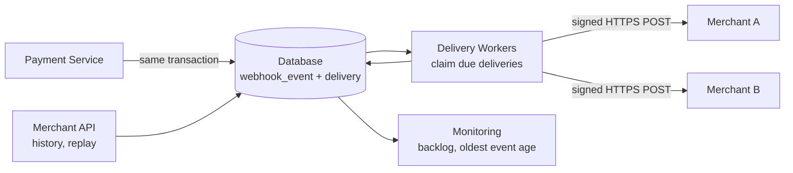
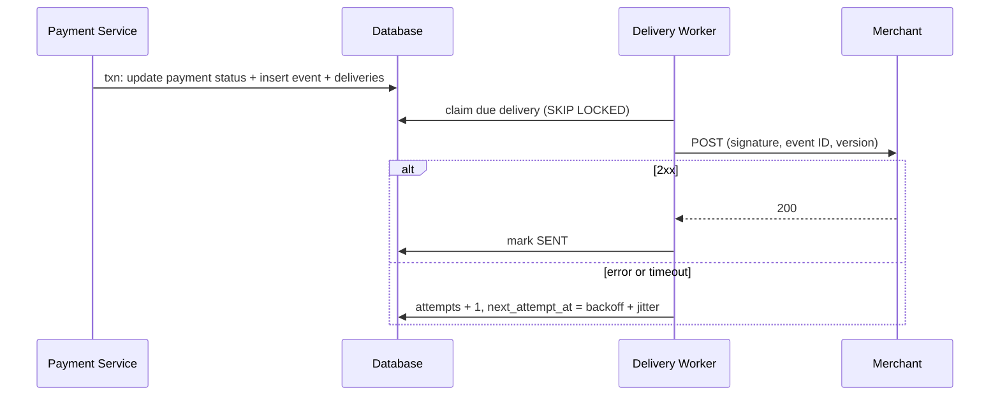

# System Design 面试准备：Webhook 通知系统

基于一次 mock interview 整理。题目：**Design a webhook system for a payments platform.**
全英文面试，所以口述稿用英文，解释用中文。支付核心流程见 `system-design-prep.md`。

---

## 1. 题目与澄清

> "When something happens to a payment, such as a capture completing, we need to notify the merchant's server by HTTP."

### 要问的问题

| 问题 | 面试官的回答 |
| --- | --- |
| 事件类型和量 | payment 事件（authorized、captured、refunded、failed 等）；平均 1,000 事件/秒，峰值 5,000；一条事件可能发给一个商户的一个或多个 URL |
| 投递保证和顺序 | 至少一次；不要求全局顺序，但同一笔支付的事件最好带版本或时间戳 |
| 重试多久 | 商户宕机时重试几天（如 3 天），超过后停止并告警 |
| 商户配置 | 商户自己注册 URL，选择订阅的事件类型 |
| 如何验证来源 | 需要签名 |
| 历史和重放 | 商户能查看投递记录，并手动重放 |
| 延迟 | 正常情况 1–2 秒内送达 |

不该问：用什么编程语言。

范围外：商户端怎么处理事件、UI 界面。

### 需求

**功能：**

1. 商户注册 webhook endpoint，选择订阅的事件类型。
2. 支付状态变化时生成事件，投递到商户 endpoint。
3. 失败时重试，超过窗口后标记失败。
4. 商户可以查看投递记录，并重放失败事件。

**非功能：**

1. **可靠**：已生成的事件不丢。
2. **隔离**：一个慢商户不影响其他商户。
3. **安全**：商户能验证来源，防重放。
4. **吞吐**：平均 1,000，峰值 5,000 事件/秒。
5. **可观测**：积压、最老事件年龄、成功率。

---

## 2. 核心设计

### 2.1 投递保证：至少一次

商户的服务可能超时、返回 500，或者已经处理了事件但我们没收到 200。我们**无法区分“没送到”和“送到了但响应丢了”**，所以只能重发。

- exactly-once 在网络上做不到。
- 做法：**至少一次投递 + 商户按 event ID 去重**，效果上只生效一次。

> "Delivery is at least once, because we can't tell whether a timeout means the merchant didn't get it or the response was lost. Every event has a stable event ID, so the merchant deduplicates, and the effect happens once."

### 2.2 产生事件：outbox

问题：支付状态在数据库里改成 CAPTURED，之后服务崩溃，事件没生成。

| 做法 | 问题 |
| --- | --- |
| 提交后直接调商户的 URL | 商户慢会拖住主流程；崩溃会丢 |
| 提交后发 Kafka，失败就记日志 | 写库和发消息是两个系统（双写），中间崩溃会丢 |
| 事件放在内存里后台发 | 崩溃就丢 |
| **同一事务里写事件行（outbox）** | **状态和事件一起成功或失败，worker 再读出来发送** |

> "In the same database transaction as the status update, we insert an event row. A separate worker reads it and delivers it, so a crash can't lose the notification."

注意：在支付系统那道题里，为了简单，同步成功时没有写 outbox。**做通用 webhook 系统时，所有事件都要写**，因为商户通常把 webhook 当作主要通知方式。可以主动说明这个区别。

### 2.3 数据模型

```text
webhook_endpoint                （商户注册）
  endpoint_id, merchant_id, url, secret, event_types, status

webhook_event                   （outbox，一个事件一行）
  event_id, merchant_id, payment_id, type, version, payload, created_at

webhook_delivery                （每个事件发给每个 endpoint 的投递状态）
  delivery_id, event_id, endpoint_id,
  status (PENDING / SENT / FAILED),
  attempts, next_attempt_at, last_http_status, sent_at
```

- 一个事件可能发给多个 endpoint，所以事件和投递分开。
- 投递记录可查询，用于商户的历史页面和重放。

### 2.4 投递 worker

```text
循环：
  1. 查询：status = PENDING 且 next_attempt_at <= now（limit N）
  2. 认领：SELECT ... FOR UPDATE SKIP LOCKED（或租约）
  3. 发送：签名 → POST 到商户 URL，短超时
  4. 更新：
     - 2xx           → SENT
     - 失败或超时     → attempts + 1，next_attempt_at = now + 指数退避 + 抖动
     - 超过重试窗口   → FAILED，告警
```

索引：`(status, next_attempt_at)`。

### 2.5 慢商户与失败处理

| 做法 | 为什么 |
| --- | --- |
| 短超时（5–10 秒） | 长超时占住 worker |
| 指数退避 + 抖动 | 商户恢复时不会被同时重试的请求打垮 |
| 有限重试窗口（如 3 天） | 不无限重试，超过转失败并告警；商户可重放 |
| 按商户限制并发，或独立队列 | 慢商户不占满所有 worker（bulkhead） |
| 熔断 endpoint | 连续失败很多次后暂停一段时间，并通知商户 |

错误做法：循环立即重试并加长超时；或者用一个共享 FIFO 队列，worker 卡在慢商户上保序。

> "We use a short timeout per request, exponential backoff with jitter, and a limited retry window. We also limit concurrency per merchant, so a slow merchant can't take all the workers."

### 2.6 安全

| 做法 | 说明 |
| --- | --- |
| HMAC 签名 | 用每个商户独立的密钥，对“时间戳 + 请求体”签名，放在请求头里 |
| 时间戳 | 包含在签名里，商户拒绝太旧的请求，防重放 |
| HTTPS | 只保护传输，不能代替签名 |
| 密钥轮换 | 新旧密钥并存一段时间 |
| 商户验证 | 用常量时间比较签名 |

不够的做法：只用 IP 白名单（IP 会变，也不能证明内容）；在 URL 里放 token（容易出现在日志里）；只用 HTTPS。

> "We sign the timestamp and the body with a per-merchant secret using HMAC. The merchant verifies the signature and rejects old timestamps, so an attacker can't forge or replay an event."

### 2.7 顺序

场景：支付先 AUTHORIZED，一秒内 CAPTURED。因为重试，商户先收到 CAPTURED。

- **不承诺全局顺序**：严格保序的代价是一个失败事件阻塞后面所有事件，吞吐低。
- 每个事件带 **event ID、创建时间、版本号（按 payment 递增）**。
- payload 尽量精简，商户收到后可以**回查 `GET /payments/{id}`** 拿最新状态。
- 如果需要部分保序，可以按 payment 分区，同一笔支付的事件在同一队列里顺序发送，但失败时仍要有超时和跳过策略。

> "We don't promise global order. Each event carries an ID and a version, and the merchant can compare versions or query the payment for its current state."

### 2.8 规模

平均 1,000，峰值 5,000 事件/秒，一个事件可能多个 URL，约 5,000–15,000 次投递/秒。

| 做法 | 说明 |
| --- | --- |
| 无状态 worker，水平扩展 | 增加 worker 即可 |
| 认领方式 | 轮询加 `SKIP LOCKED`；规模大时用 CDC 把 outbox 变成队列（如 Kafka），消费者投递 |
| 按分片或商户划分 | 每个 worker 负责若干分片 |
| 按商户限速 | 保护商户，也保护我们 |
| 监控 | 积压数量、最老事件年龄、成功率、按商户拆分 |

### 2.9 商户运维

- 投递记录：每次尝试的时间、HTTP 状态、耗时。
- 手动重放：把失败的投递重新置为 PENDING。
- 自动停用：endpoint 长期失败，暂停并通知商户。

---

## 3. 架构图





---

## 4. 一分钟总结稿

> "We guarantee at-least-once delivery. When a payment changes status, we save an event row in the same database transaction, so we never lose a notification. Stateless workers claim due events and send a signed HTTP request, signed with HMAC and a timestamp, with a short timeout. On failure, we retry with exponential backoff and jitter for a limited window, and we limit concurrency per merchant so one slow merchant can't affect others. Events can arrive out of order, so each has an event ID and a version, and merchants can query the payment for its current state. We scale the workers horizontally and monitor backlog and the age of the oldest event. Merchants can see delivery history and replay failed events."

---

## 5. 追问与答案

| 问题 | 答案要点 |
| --- | --- |
| Exactly-once? | 做不到；至少一次加商户按 event ID 去重 |
| Why not call the merchant directly in the request? | 商户慢会拖住主流程，失败会丢；用 outbox 异步 |
| Why not publish to Kafka after commit? | 双写问题，中间崩溃会丢；outbox 同事务，或者用 CDC 再接 Kafka |
| Merchant is down for days? | 退避重试，窗口（3 天）后标记失败并告警，商户恢复后重放或查询 |
| One slow merchant? | 短超时，按商户限制并发或独立队列，熔断 endpoint |
| Ordering? | 不承诺全局顺序；版本号 + 回查 GET；可按 payment 分区部分保序 |
| How do you secure it? | HMAC 签名含时间戳，每商户密钥，HTTPS，密钥轮换 |
| What if the worker crashes after sending but before marking SENT? | 会重发；这就是至少一次，商户去重 |
| How do you scale? | 无状态 worker，SKIP LOCKED 或 CDC，分片，按商户限速 |
| How do you monitor? | 积压、最老事件年龄、成功率、按商户拆分；对症状告警 |
| How does a merchant recover missed events? | 查看投递记录，手动重放；或回查 GET |
| One event, many endpoints? | 事件和投递分开表，每个 endpoint 一条投递，各自重试 |
| Thin or fat payload? | 精简 payload，加回查 GET，避免过时数据和泄露敏感信息 |

---

## 6. 你的经验怎么接

以下需要符合你的真实情况，面试前请自己核对。

- **TasCreed 的认领、租约和心跳**：对应 worker 认领投递任务、崩溃后任务被其他节点接手。
- **指数退避和 kill 机制**：你给框架加过指数退避和 kill API，对应 webhook 的退避和熔断或停用 endpoint。
- **监控 portal**：对应商户和运维查看积压、重放失败事件。

不要说成自己设计了 TasCreed，你的角色是重度使用者，发现问题就主动改框架。

---

## 7. 易错点

| # | 容易犯的错 | 正确要点 |
| --- | --- | --- |
| 1 | 承诺 exactly-once | 至少一次 + 去重 |
| 2 | 提交后直接发消息或调商户 | 同事务写事件行 |
| 3 | 立即无限重试，长超时 | 短超时，退避加抖动，有限窗口 |
| 4 | 共享队列保序，慢商户阻塞所有人 | 按商户隔离，不承诺全局顺序 |
| 5 | 只靠 HTTPS 或 IP 白名单 | HMAC 签名加时间戳 |
| 6 | 忘记商户的运维需求 | 投递记录、重放、自动停用 |
